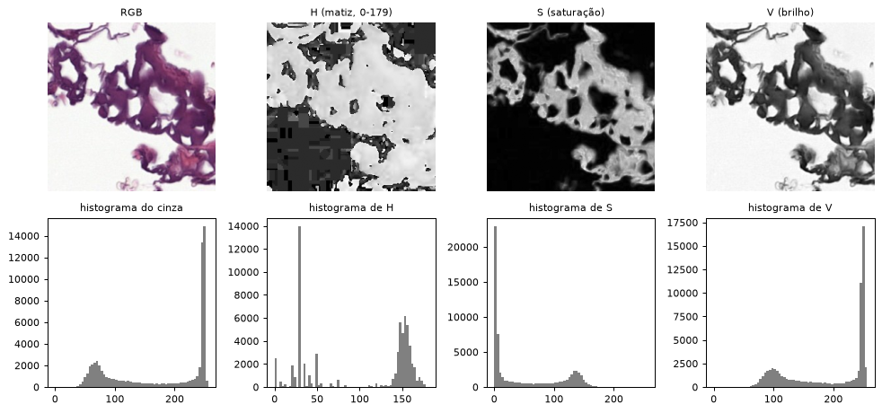
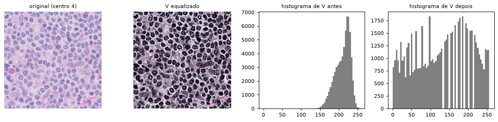
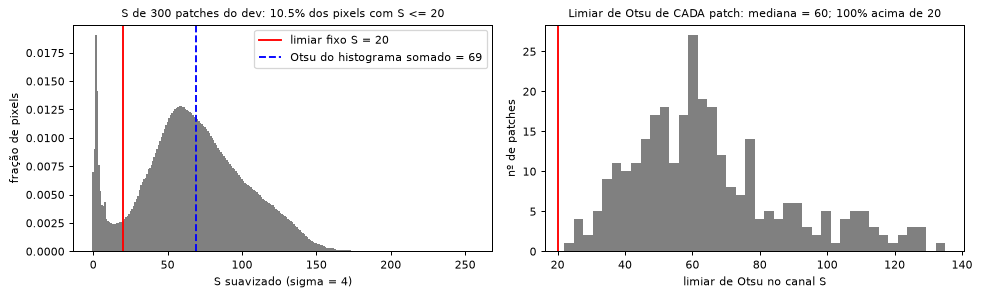
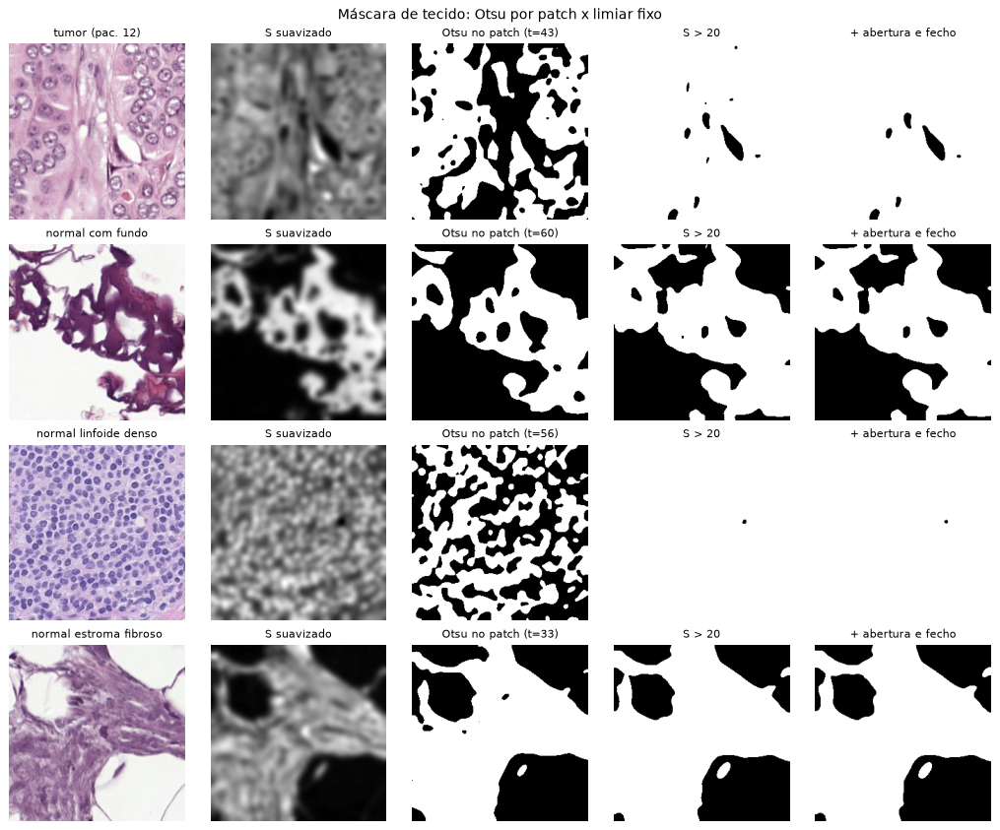
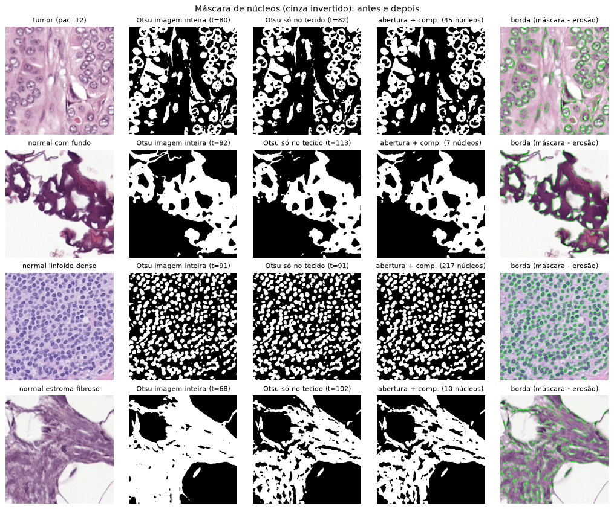
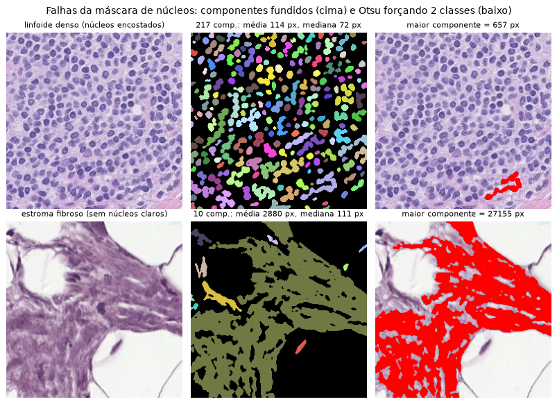

# Integrante 2 — Pré-processamento e segmentação

Aulas: **Fundamentos**, **Segmentação** e **Morfologia**. Código: `src/color.py` e `src/segmentation.py`.
Leia antes o `docs/RESUMO.md`.

## a) O que você precisa dominar

1. Conversão RGB → HSV e o que cada canal significa
2. Histograma por canal (o que vira feature)
3. Equalização de histograma no canal V
4. Por que o Otsu no canal S **falhou** para separar tecido de fundo
5. A máscara de tecido com limiar fixo S > 20
6. A máscara de núcleos: Otsu no cinza invertido, só dentro do tecido
7. Abertura, fecho, componentes conexos e as falhas da máscara de núcleos

## b) Explicação de cada tópico

**1. HSV** — `src/color.py::rgb_to_hsv`. **H** é a matiz ("qual cor"), **S** a saturação ("quão
pura") e **V** o brilho (max(R, G, B)). No OpenCV: S = 255·(V − min)/V, e H vai de 0 a 179 (graus/2).
O fundo branco (240, 240, 240) tem S = 0; o estroma rosa (230, 160, 200) tem S = 78; o núcleo roxo
(90, 40, 120) tem S = 170. Por isso o **S separa fundo de tecido**.

**2. Histograma por canal** — `src/color.py::channel_histograms`. Conta os pixels em 8 faixas por canal
e divide pelo total (soma 1). São 3 × 8 = 24 features de cor. O H tem faixas de 22,5 (0–179); o S e o V,
faixas de 32 (0–255).

**3. Equalização** — `src/color.py::equalize_v`. Aplica `cv2.equalizeHist` **só no V**, para aumentar o
contraste sem mudar a cor. A fórmula é v' = (CDF(v) − CDF_min)·255/(N − CDF_min). Exemplo: os pixels
[50, 50, 50, 50, 60, 60, 70, 80] viram [0, 0, 0, 0, 128, 128, 191, 255]. Está implementada e no EDA,
mas **não entra** nas features nem na CNN.

**4. Por que o Otsu no S falhou.** O Otsu testa todos os limiares t e escolhe o que maximiza a
variância entre as duas classes: σ²_B = ω0·ω1·(μ0 − μ1)². Ele **sempre** acha duas classes. Só 10,5% dos
pixels (300 patches) têm S ≤ 20; a maioria dos patches é só tecido. Então as "duas classes" viram
**núcleo × estroma**, não tecido × fundo: o limiar de Otsu de cada patch teve mediana ≈ 60, e 100% dos
patches ficaram acima de 20.

**5. Máscara de tecido** — `src/segmentation.py::tissue_mask`. É feita em quatro passos:
(1) canal S; (2) Gaussiano com σ = 4, para pegar regiões e não pixels; (3) **S > 20**, o vale do
histograma acima (limiarização global); (4) abertura e fecho com elipse 5×5. Com `threshold=None`, a
função usa o Otsu do patch, o que serve para mostrar a comparação.

**6. Máscara de núcleos** — `src/segmentation.py::nuclei_mask`. É feita em cinco passos:
(1) cinza + Gaussiano 5×5; (2) **inverte**, porque os núcleos são os mais escuros e passam a ser os mais
claros; (3) **Otsu calculado só com os pixels de tecido** (`inv[tissue > 0]`); (4) abertura 3×3;
(5) componentes conexos, apagando os de menos de 15 px. Sem o passo 3, num patch com fundo o Otsu separa
fundo × tecido e marca **o tecido inteiro** como núcleo.

**7. Morfologia e componentes conexos** — `open_close`, `extract_border` e `remove_small_components`.
- **Erosão** encolhe a máscara (o pixel fica 1 só se o elemento estruturante cabe inteiro dentro dela);
  **dilatação** engorda.
- **Abertura** = erosão → dilatação: remove pontos soltos. **Fecho** = dilatação → erosão: tapa buracos.
- **Borda** = máscara − erosão.
- **Componentes conexos** (vizinhança-8): cada grupo de pixels 1 que se toca vira um "núcleo", com sua área.

Há duas falhas. (a) Núcleos **encostados** viram um componente só (efeito moderado: o maior tem 657 px
num patch linfoide). (b) No **estroma escuro**, o Otsu é obrigado a criar duas classes e marca o próprio
estroma como "núcleo" (um componente de 27.155 px).

> A lista da aula de Segmentação traz Otsu, limiar adaptativo e crescimento de região. Componentes conexos
> são um crescimento de região em que o critério é "pixel = 1". Confirme com o professor como isso foi chamado em aula.

## c) Decisões que tomamos e por quê

| decisão | por quê | onde |
|---|---|---|
| HSV em vez de RGB para fundo e cor | S separa fundo (≈ 0) de tecido; H isola o tom da coloração | `color.py` |
| 8 bins por canal | o suficiente para descrever a cor sem criar features demais | `features.hsv_bins` |
| Tecido com **S > 20 fixo**, não Otsu | o Otsu sempre acha 2 classes, e quase nenhum patch tem fundo | `tissue_mask`, `tissue_threshold` |
| Gaussiano σ = 4 antes do limiar | a máscara pega regiões, não núcleo por núcleo | `tissue_blur_sigma` |
| Otsu dos núcleos **só no tecido** | com fundo, o Otsu da imagem toda separa fundo × tecido | `nuclei_mask` |
| Abertura 3×3 nos núcleos, 5×5 no tecido | núcleos são pequenos e uma abertura grande os apagaria | `nuclei_kernel`, `tissue_kernel` |
| Área mínima de 15 px | componentes menores são ruído; um núcleo típico tem ~70 px | `nuclei_min_area` |
| Equalização fora do pipeline | testamos só visualmente; não há experimento mostrando ganho | `equalize_v` |

## d) Perguntas prováveis da defesa

1. **Por que HSV?** Porque separa cor (H), pureza (S) e brilho (V). O fundo tem S ≈ 0 e o tecido
   corado tem S alto, então um limiar só em S já separa os dois.
2. **Como o OpenCV representa o H?** Em graus divididos por 2 (0–179), para caber num uint8.
   Por isso o histograma de H usa a faixa 0–180.
3. **Por que equalizar só o V?** Equalizar R, G e B separadamente muda as cores. No V só o brilho
   muda, e a matiz e a saturação ficam iguais.
4. **Como o Otsu escolhe o limiar?** Testa todo t e escolhe o que maximiza σ²_B = ω0·ω1·(μ0 − μ1)².
   Num histograma de 8 níveis [2, 5, 8, 3, 1, 4, 9, 4], o melhor é t = 3 (σ²_B = 4,46).
5. **Por que o Otsu falhou no S?** Ele sempre divide em duas classes. Sem fundo no patch, divide o
   tecido em núcleo × estroma: limiar mediano ≈ 60, sempre acima de 20.
6. **De onde veio o 20?** Do vale do histograma de S somado em 300 patches: pico estreito perto de 0
   (fundo), vale por volta de 20 e depois o "morro" do tecido.
7. **Por que inverter o cinza nos núcleos?** Os núcleos (hematoxilina) são os pixels mais escuros.
   Invertendo, eles ficam acima do limiar, e o Otsu marca 1 nos núcleos.
8. **Por que o Otsu só dentro do tecido?** Com fundo branco, as duas classes da imagem inteira são
   fundo × tecido, e o tecido todo viraria núcleo. Restringindo, as classes viram núcleo × resto.
9. **Para que servem a abertura e o fecho?** A abertura (erosão + dilatação) remove pontos e pontes
   finas; o fecho (dilatação + erosão) tapa buracos e frestas.
10. **Quais são as falhas da máscara de núcleos?** Núcleos encostados se fundem num componente, e no
    estroma escuro o Otsu marca o próprio estroma como núcleo. Isso deixa a feature "área média" ruidosa.

## e) O mínimo que você precisa saber das outras partes

- Dados: o centro 2 é o teste externo, usado uma vez; o resto é dividido em 4 folds **por paciente** (integrante 1).
- As suas máscaras viram 3 das 30 features (fração, número e área média dos núcleos), e o histograma HSV vira 24 (integrante 3).
- O baseline é StandardScaler + regressão logística com `class_weight="balanced"` (integrante 3).
- A CNN não usa as máscaras: recebe o patch 128×128 com pixels/255 (integrante 4).
- As métricas principais são acurácia balanceada, F1 macro e AUC, porque a acurácia engana com 92% de normais (integrante 4).
