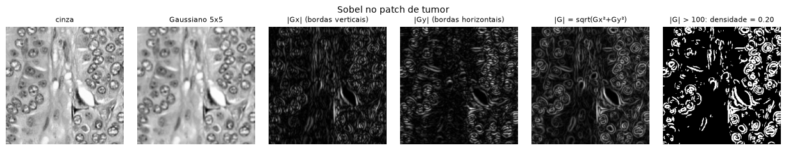
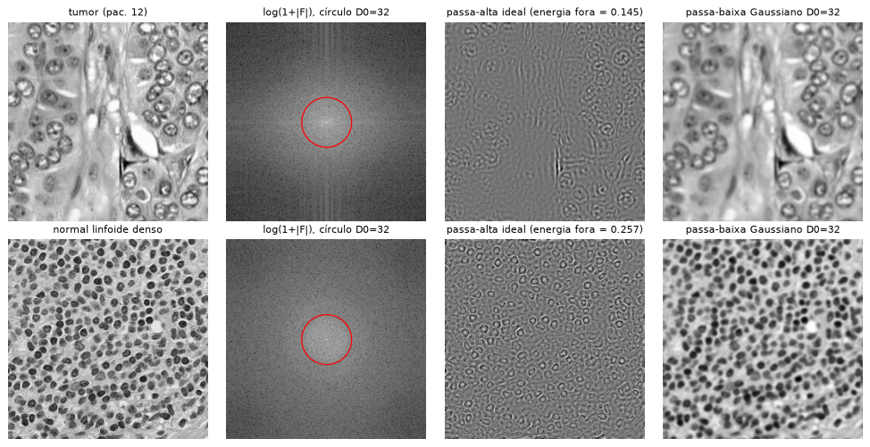
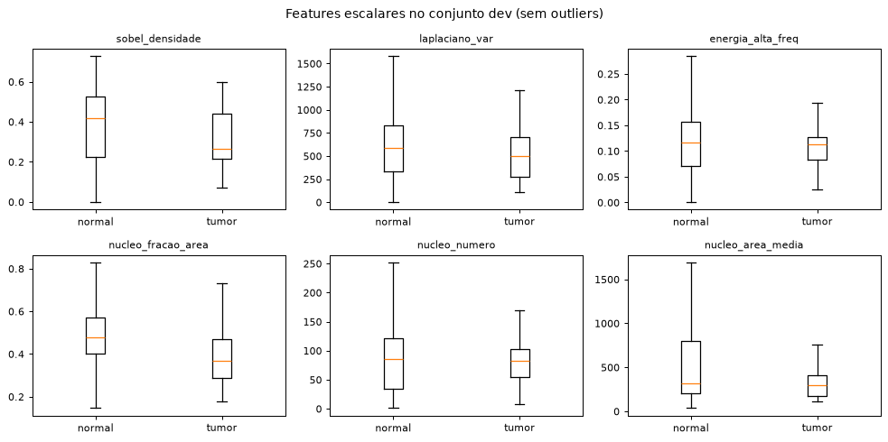

# Integrante 3 — Filtros, features e baseline clássico

Aulas: **Filtros no espaço**, **Frequência** e **Restauração**. A regressão logística **não é de aula**.
Código: `src/filters.py`, `src/features.py`, `src/models.py::build_logreg` e `src/restoration.py`.
Leia antes o `docs/RESUMO.md`.

## a) O que você precisa dominar

1. Convolução 3×3, Gaussiano e Sobel (densidade de bordas)
2. Variância do Laplaciano
3. FFT, espectro centralizado e energia de alta frequência
4. O vetor de 30 features (o que se espera em tumor × normal)
5. Padronização (StandardScaler)
6. Regressão logística e `class_weight="balanced"`
7. Restauração: ruídos e filtros de média, mediana e Gaussiano

## b) Explicação de cada tópico

**1. Convolução, Gaussiano e Sobel** — `src/filters.py::sobel_magnitude` e `edge_density`. Um filtro
espacial multiplica uma janela de pixels pelos pesos da máscara e soma. Exemplo de borda vertical,
com as colunas [10, 10, 200] repetidas em 3 linhas:
- **média 3×3**: (6·10 + 3·200)/9 = 73 (borra);
- **Sobel Gx** = [−1 0 1; −2 0 2; −1 0 1]: 190 + 2·190 + 190 = **760**; Gy = 0;
- magnitude = √(Gx² + Gy²) = 760.

A feature `sobel_densidade` é a **fração de pixels com magnitude > 100**, calculada depois de um
**Gaussiano 5×5**: o Sobel é uma derivada e amplifica ruído, então suavizamos antes.


**2. Variância do Laplaciano** — `src/filters.py::laplacian_variance`. Usa o kernel [0 1 0; 1 −4 1; 0 1 0]
(no exemplo acima, dá 190 no centro). Uma imagem nítida tem muitas transições bruscas: valores grandes e,
portanto, **variância alta**. Uma imagem borrada tem variância baixa. A feature mede nitidez e detalhe.

**3. FFT e energia de alta frequência** — `centered_fft`, `log_spectrum` e `high_freq_energy`. A DFT
descreve a imagem como soma de ondas. O `fftshift` leva a frequência zero para o centro: perto do centro
ficam as variações lentas, longe dele as bordas e a textura fina. A feature é:

```
energia_alta_freq = Σ_{D(u,v) > D0} |F|² / Σ |F|²      (D0 = 32; F calculada de g − média(g))
```

É o que um **passa-alta ideal** deixaria passar. Subtraímos a média porque senão o termo DC (brilho médio)
domina e a fração fica sempre perto de 0. O `gaussian_lowpass` (H = exp(−D²/2D0²)) aparece só no EDA.


**4. O vetor de 30 features** — `src/features.py::patch_features`:
- 24 de histograma HSV (cor);
- `sobel_densidade`, `laplaciano_var`, `energia_alta_freq`;
- 3 de núcleos: `nucleo_fracao_area` (pixels de núcleo / pixels de tecido), `nucleo_numero` e
  `nucleo_area_media`, vindas das máscaras do integrante 2.

São calculadas no patch 256×256 e salvas em `data/features.parquet` (180 s para 26.753 patches).
O normal do linfonodo é cheio de **linfócitos** pequenos e escuros (muitas bordas e núcleos); o tumor tem
células maiores e mais claras. Medianas no dev, normal × tumor: Sobel 0,42 × 0,26; fração nuclear 0,48 ×
0,37; energia de alta frequência 0,117 × 0,113 (quase igual).


**5. StandardScaler** (não é de aula). A fórmula é z = (x − média)/desvio, calculada **só no treino de cada
fold**: está dentro do `make_pipeline`, o que evita vazamento. Exemplo: no fold 0, `laplaciano_var` tem média
565 e desvio 334, então o valor 800 vira z = 0,70. Sem isso, as features com valores na casa das centenas dominariam as de valor 0,01.

**6. Regressão logística e class_weight** (não é de aula) — `src/models.py::build_logreg`. Calcula
s = Σ wᵢ·zᵢ + b e p = 1/(1 + e^(−s)); é tumor se p ≥ 0,5 (fronteira linear). Os pesos minimizam a log-loss
com penalidade L2 (C = 1).

O `class_weight="balanced"` multiplica o erro de cada classe por N/(2·N_c). No fold 0: normal 0,549 e
tumor 5,569; assim as duas classes pesam o mesmo no total. **Cuidado:** os 8 bins de cada canal somam 1
(multicolinearidade), então os pesos individuais não são interpretáveis.

**7. Restauração** (Entrega 3; funções prontas e testadas, sem experimentos) — `src/restoration.py`:
- `add_gaussian_noise` (σ de 5 a 40), `add_salt_pepper` (1% a 20% dos pixels) e `add_blur` (σ de 0,5 a 3),
  com níveis de 1 a 5 em `degrade`;
- `restore` com mediana, média ou Gaussiano. A **mediana** é a melhor contra sal-e-pimenta, porque ignora
  valores extremos em vez de fazer a média com eles (testado em `tests/test_restoration.py`).

Os filtros de máximo e mínimo da aula **não estão implementados**.

## c) Decisões que tomamos e por quê

| decisão | por quê | onde |
|---|---|---|
| Gaussiano 5×5 antes do Sobel | o Sobel (derivada) amplifica ruído | `edge_density` |
| Limiar do Sobel = 100 | a magnitude típica fica entre 68 (mediana) e 168 (p90); 100 varia bem entre patches | `sobel_threshold` |
| D0 = 32 px | 1/8 da largura do patch; escolhido à mão | `hf_radius` |
| Subtrair a média antes da FFT | o DC dominaria a energia | `high_freq_energy` |
| Features no patch 256×256, não no 128 | preserva o detalhe fino (núcleos) | `features.py` |
| Salvar em parquet | recalcular leva 3 min | `save_features` |
| Regressão logística como baseline | simples, rápida (< 1 s) e explicável | `build_logreg` |
| Scaler dentro do pipeline | ajustado só no treino de cada fold, sem vazamento | `make_pipeline` |
| `class_weight="balanced"` | só ~8% do dev é tumor | `build_logreg` |
| LBP e normalização Macenko removidos | não fazem parte do conteúdo das aulas | — |

## d) Perguntas prováveis da defesa

1. **O que é uma convolução?** Passar uma máscara sobre a imagem, multiplicando cada pixel da janela
   pelo peso correspondente e somando. O resultado vira o novo valor do pixel central.
2. **Por que um Gaussiano antes do Sobel?** O Sobel aproxima uma derivada, e derivadas amplificam ruído.
   O Gaussiano 5×5 (σ ≈ 1,1) suaviza antes, para medir bordas reais.
3. **O que mede a variância do Laplaciano?** Nitidez. O Laplaciano reage a transições bruscas: imagem
   nítida dá variância alta; borrada, baixa.
4. **O que é o fftshift?** Desloca a frequência zero (DC) para o centro do espectro. Assim, as baixas
   frequências ficam no meio e as altas nas bordas, como nas figuras da aula.
5. **O que é a energia de alta frequência?** A fração de |F|² fora do círculo de raio D0 = 32, ou seja,
   o que passaria num passa-alta ideal. Mede textura fina.
6. **Por que subtrair a média antes da FFT?** O termo DC é o brilho médio e concentra quase toda a energia.
   Sem tirar a média, a fração de alta frequência ficaria sempre perto de zero.
7. **Quais features separam melhor tumor de normal?** A densidade de bordas (0,26 × 0,42) e a fração
   nuclear (0,37 × 0,48). A energia de alta frequência e o número de núcleos quase não mudam.
8. **Por que padronizar e por que só no treino?** As features têm escalas muito diferentes. Ajustar o
   scaler em todo o conjunto usaria informação da validação, o que é vazamento.
9. **Como a regressão logística decide?** Soma ponderada das features, sigmoide e limiar em 0,5.
   A fronteira é um hiperplano.
10. **Por que a mediana é melhor contra sal-e-pimenta?** O ruído são valores extremos (0 ou 255). A média
    os mistura aos vizinhos; a mediana simplesmente os ignora.

## e) O mínimo que você precisa saber das outras partes

- Os folds são por paciente e o centro 2 só é usado no fim; o scaler e o modelo são ajustados só no treino de cada fold (integrante 1).
- As 3 features de núcleo vêm de `tissue_mask` (S > 20) e `nuclei_mask` (Otsu só no tecido), que falham em tecido escuro (integrante 2).
- A CNN usa a mesma fórmula de peso de classe, N/(2·N_c), na CrossEntropy (integrante 4).
- A regressão logística não precisa de early stopping; a CNN para por um conjunto de pacientes separado do treino (integrante 4).
- Nos centros 4 e 5 (só normais), a regressão logística errou pouquíssimo, enquanto a CNN errou muito (integrante 4).
