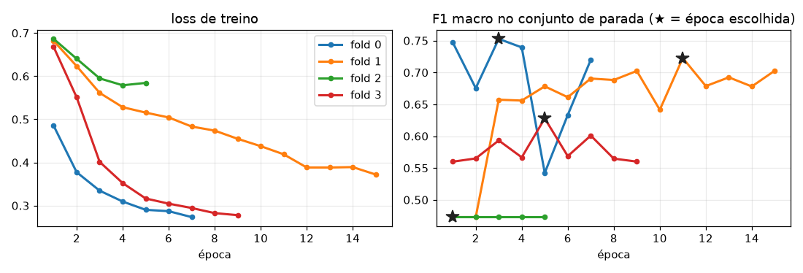

# Integrante 4 — CNN e avaliação

Aula: **Classificação** (CNN). O Adam, o early stopping e as métricas são metodologia (não são de aula).
Código: `src/models.py::SimpleCNN`, `src/train.py`, `src/evaluate.py` e `src/viz.py`.
Leia antes o `docs/RESUMO.md`.

## a) O que você precisa dominar

1. A arquitetura camada por camada (formato e parâmetros)
2. O treino: CrossEntropy ponderada, Adam e aumentação
3. A learning rate: o que aconteceu com 1e-3
4. O early stopping com conjunto de parada
5. As métricas por patch, por paciente e por centro
6. Os resultados de CV e do centro 2
7. A análise de erros

## b) Explicação de cada tópico

**1. Arquitetura** — `SimpleCNN`. É a rede do slide (Keras) escrita em PyTorch. Entrada: 3×128×128, pixels/255.

| camada | saída | parâmetros |
|---|---|---|
| Conv2d(3→32, 3×3) + ReLU | 32×126×126 | (3·3·3+1)·32 = 896 |
| MaxPool 2×2 | 32×63×63 | 0 |
| Conv2d(32→64, 3×3) + ReLU | 64×61×61 | (3·3·32+1)·64 = 18.496 |
| MaxPool 2×2 | 64×30×30 | 0 |
| Conv2d(64→64, 3×3) + ReLU | 64×28×28 | (3·3·64+1)·64 = 36.928 |
| Flatten | 50.176 | 0 |
| Linear(50.176→64) + ReLU | 64 | (50.176+1)·64 = 3.211.328 |
| Linear(64→2) | 2 (logits) | 130 |

Total: **3.267.778** parâmetros, 98% na primeira densa. Uma conv 3×3 sem padding perde 2 px; o pool
divide por 2. A ReLU (max(0, x)) dá a não linearidade. Não há softmax no fim porque a `CrossEntropyLoss`
já aplica um. **Confira com o slide:** o código Keras nos comentários foi reconstruído a partir da descrição.

**2. Treino** — `fit_cnn` e `train_one_epoch`. Para cada lote: `zero_grad` → forward → loss →
`backward` (gradientes) → `optimizer.step()`.
- **CrossEntropy:** loss = −ln(p da classe certa), com **peso de classe** N/(2·N_c) (≈ 0,55 para normal
  e ≈ 5,6 para tumor).
- **Adam:** passo na direção do gradiente, com média móvel (momento) e um passo ajustado para cada peso.
- **Aumentação** (só no treino): rotações de 0/90/180/270° e flip, que dão as 8 orientações. Tecido não
  tem "lado de cima", e essas transformações não inventam pixels. Lote de 64.

**3. Learning rate.** Com lr = 1e-3 a loss oscilou e, em algumas execuções, ficou presa em **0,69 = ln 2**.
Isso é a loss de uma rede que responde **sempre 50/50**: com o peso balanceado, uma saída constante não
consegue fazer melhor. Com **1e-4** a loss cai de forma contínua (no fold 1, AUC 0,97 contra 0,80 em 6 épocas).
A explicação provável é que passos grandes na densa de 3,2 milhões de pesos "matam" as ReLUs.

**4. Early stopping com conjunto de parada** — `splits.early_stopping_split` e `fit_cnn`.
- Dentro do treino de cada fold, ~1/5 dos pacientes (com um paciente com tumor) viram o **conjunto de parada**.
- A cada época medimos a F1 macro nele, guardamos o melhor checkpoint e paramos depois de **4 épocas sem
  melhora** (no máximo 20). O fold de validação só é usado no fim, para **medir**.
- Melhores épocas nos folds 0–3: **3, 11, 1 e 5**.
- No fold 2, o conjunto de parada caiu com o **paciente 16** (tumor de região única): a F1 de parada nunca
  subiu, a época 1 foi escolhida e a rede previu tudo como normal.
- No modelo final, o conjunto de parada levou o **paciente 12**, que tem o tumor mais variado. Ou seja, ele
  não entrou no ajuste dos pesos.

**5. Métricas** — `compute_metrics`, `group_metrics` e `patient_summary`. O limiar é 0,5.
- Por patch: acurácia, **acurácia balanceada** (média dos recalls), **F1 macro** (média dos F1),
  **AUC** (ordem: P(nota do tumor > nota do normal)), precisão, recall e especificidade.
- **Por paciente:** cada paciente pesa igual. É a média do recall dos pacientes com tumor e da
  especificidade dos pacientes.
- **Por centro:** centros sem tumor (4 e 5) têm só a especificidade.
- A acurácia sozinha engana: "sempre normal" teria 91,6% no dev.

**6. Resultados** (tabela completa no RESUMO). Na CV, CNN e regressão logística empatam (acurácia
balanceada 0,67 × 0,63, com desvio de ±0,2). No **centro 2**, as duas têm recall de tumor ≈ 0. Mas a CNN
tem **AUC 0,70** (por paciente: 0,72; 0,92; 0,59; 0,94): ela ainda **ordena** os tumores acima dos normais,
só que com probabilidades baixas. O limiar 0,5 do dev não transfere. A regressão logística tem AUC 0,42.

**7. Erros** — `viz.errors_figure`. Os falsos positivos mais confiantes da CNN são **estroma rosa** (pacientes
14, centro 0, e 83, centro 4) e tecido linfoide do paciente 6. Os falsos negativos são do paciente 39
(centro 1, tecido roxo-escuro). Nos centros
só com normais, a CNN marcou como tumor **42% (centro 4) e 88% (centro 5)**; a regressão logística, 1% e 0%.
Isso é mudança de domínio dentro do próprio dev.

## c) Decisões que tomamos e por quê

| decisão | por quê | onde |
|---|---|---|
| Arquitetura do slide, entrada 128 | pedido do grupo; 128 = 256/2 cabe em 8 GB e é rápido | `SimpleCNN`, `cnn.image_size` |
| Pixels/255, sem outra normalização | simples e dentro do conteúdo das aulas | `PatchDataset` |
| Peso de classe na CrossEntropy | só ~8% do treino é tumor | `class_weights` |
| lr = 1e-4 | com 1e-3 o treino foi instável | `cnn.lr` |
| Aumentação só com rotações de 90° e flips | tecido sem orientação; não inventa pixels | `data.augment` |
| Parada pela F1 macro do conjunto de parada | a validação não pode influenciar o treino | `fit_cnn` |
| Paciência 4, máximo de 20 épocas | combinado pelo grupo | `cnn.patience` |
| Métricas por paciente e por centro | patches do mesmo paciente não são independentes | `patient_summary` |
| Limiar fixo em 0,5 | não ajustamos nada olhando o teste | `compute_metrics` |

## d) Perguntas prováveis da defesa

1. **Como o tamanho muda ao longo da rede?** 128 → 126 (conv) → 63 (pool) → 61 → 30 → 28, ou seja,
   64×28×28 = 50.176 valores no Flatten.
2. **Onde estão os parâmetros?** 98% (3,21 milhões) na primeira densa, que liga 50.176 entradas a 64
   neurônios. As convoluções têm só ~56 mil.
3. **Para que servem a ReLU e o MaxPool?** A ReLU dá a não linearidade; sem ela, a rede seria uma
   transformação linear. O MaxPool reduz a resolução pela metade, guardando o maior valor de cada bloco 2×2.
4. **Por que a loss presa em 0,69 indica falha?** 0,69 = ln 2 = −ln(0,5), a loss de quem responde sempre
   50/50. Com o peso balanceado, é o melhor que uma saída constante consegue.
5. **O que é o peso de classe?** O erro de cada classe é multiplicado por N/(2·N_c), e um erro em tumor
   pesa ~10 vezes mais. Sem isso, a rede aprenderia a dizer sempre "normal".
6. **Por que separar pacientes para a parada?** Se a época for escolhida pela validação, a métrica de
   validação fica otimista. Agora a validação só mede.
7. **Por que o fold 2 deu recall zero?** O conjunto de parada continha o paciente 16 (tumor de região
   única): a F1 de parada não subiu, a parada ficou na época 1 e a rede previu tudo como normal.
8. **Qual a diferença entre acurácia balanceada e F1 macro?** A primeira é a média dos recalls das duas
   classes; a segunda, a média dos F1 (que incluem a precisão). Com muitos falsos positivos, o F1 do tumor cai.
9. **Como a AUC da CNN é 0,70 no centro 2 se o recall é ~0?** A AUC olha só a ordem: os tumores recebem
   notas maiores que os normais, mas abaixo de 0,5. O problema é o limiar (calibração), não só a ordem.
10. **O que os centros 4 e 5 mostram?** Mudança de domínio já no dev: a CNN marcou como tumor 42% e 88%
    dos normais desses centros. A cor diferente engana a rede.

## e) O mínimo que você precisa saber das outras partes

- Os folds são por paciente; o centro 2 foi testado uma vez, com trava e registro no `run_info.json` (integrante 1).
- Os pacientes 16, 17 e 41 têm tumor de região única (300 patches quase iguais), o que explica parte do desvio (integrante 1).
- A regressão logística usa 30 features: 24 de cor (HSV) + Sobel + Laplaciano + alta frequência + 3 de núcleos (integrante 3).
- As features de núcleo vêm de máscaras com S > 20 e Otsu dentro do tecido, que falham em tecido escuro (integrante 2).
- A regressão logística padroniza as features só no treino de cada fold e usa o mesmo peso de classe N/(2·N_c) (integrante 3).
