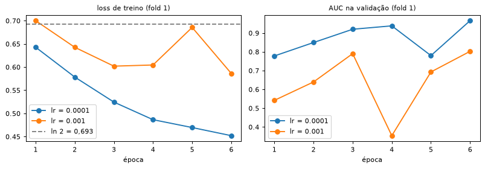
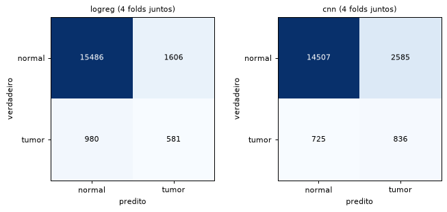
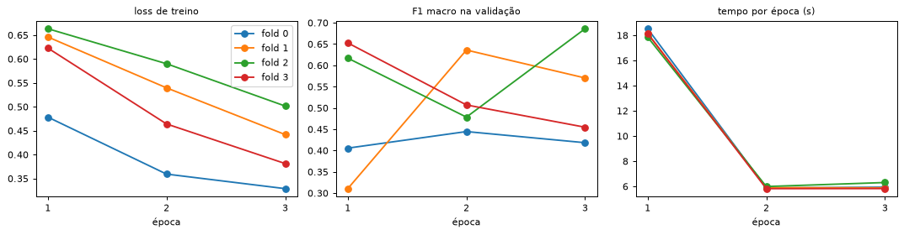
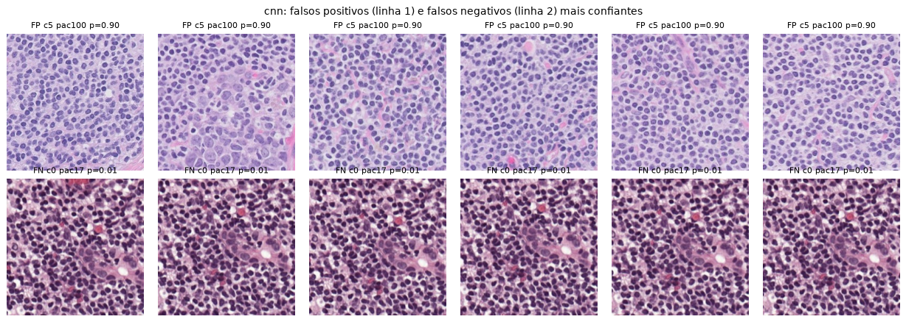
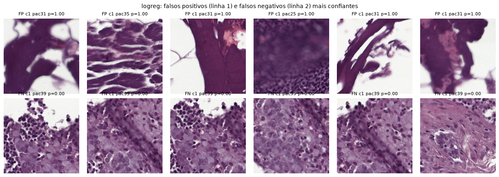

# Entendendo o projeto PathoShift — documentação de estudo (referência completa)

> **Aviso: este documento descreve o estado do commit `ad43a5c`, ANTES do fechamento da Entrega 1.**
> Ele continua válido para as técnicas (seções 2 a 8), mas estes pontos mudaram depois:
> - **Early stopping:** a CNN agora para pela F1 macro de um **conjunto de parada**, formado por
>   pacientes separados do treino de cada fold (`src/splits.py::early_stopping_split`). O fold de
>   validação só mede. A ressalva da seção 9.5 foi resolvida.
> - **Reprodutibilidade:** `utils.set_seed` agora ativa `cudnn.deterministic`, e duas execuções iguais
>   da CNN dão números idênticos. A limitação 6 da seção 13 foi resolvida.
> - **Resultados:** a CNN foi treinada com até 20 épocas e o teste no centro 2 foi executado. Os números das
>   seções 9 e 11 estão **desatualizados**; os atuais estão em `docs/RESUMO.md` e `outputs/metrics.json`.
> - **CLI:** `predict` e `evaluate` foram implementados; `train --final` agora só treina o modelo final.
>   `features --limit` não sobrescreve mais o arquivo completo.
> - Os documentos de estudo por integrante estão em `docs/integrante_*.md`.

> **Para quem é:** um integrante do grupo que sabe Python, mas não escreveu este código, e precisa
> explicar cada decisão numa defesa oral.
>
> **Como foi escrito:** cada afirmação técnica foi conferida no código do commit `ad43a5c` e nos
> arquivos gerados em `data/` e `outputs/` (16/10/2026). As referências seguem o formato
> `arquivo::função`. Os números vêm de scripts executados sobre esses arquivos, e não de memória.
> Quando algo vem do histórico da sessão de trabalho (e não do código), o texto diz isso.
>
> **Numeração das aulas:** as docstrings do código usam "Aula 01 – Fundamentos", "Aula 03 – Filtros
> no espaço", "Aula 04 – Frequência", "Aula 05 – Restauração", "Aula 06 – Segmentação",
> "Aula 07 – Morfologia" e "Aula 08 – Classificação". **Essa numeração foi inferida, não conferida com o
> plano da disciplina.** Aqui uso principalmente os **nomes** das aulas.

---

## Sumário

1. [Visão geral](#1-visão-geral)
2. [Glossário](#2-glossário)
3. [O dataset](#3-o-dataset)
4. [Particionamento dos dados](#4-particionamento-dos-dados)
5. [O pipeline, arquivo por arquivo](#5-o-pipeline-arquivo-por-arquivo)
6. [Baseline clássico: padronização e regressão logística](#6-baseline-clássico-padronização-e-regressão-logística)
7. [A CNN](#7-a-cnn)
8. [Métricas](#8-métricas)
9. [Resultados atuais](#9-resultados-atuais)
10. [Registro de decisões e correções](#10-registro-de-decisões-e-correções)
11. [Como rodar tudo](#11-como-rodar-tudo)
12. [O que está incompleto](#12-o-que-está-incompleto)
13. [Limitações conhecidas](#13-limitações-conhecidas)
14. [Registro do uso de IA](#14-registro-do-uso-de-ia)
15. [Perguntas prováveis na defesa](#15-perguntas-prováveis-na-defesa)

---

## 1. Visão geral

**O problema.** Temos *patches* (recortes pequenos) de lâminas de linfonodo coradas com H&E
(hematoxilina, que deixa os núcleos roxos, e eosina, que deixa o citoplasma e o estroma rosa).
Queremos classificar cada patch como **normal (0)** ou **tumor (1)**: metástase de câncer de mama.

Há duas dificuldades centrais:

- **Desbalanceamento.** Só cerca de 10% dos patches são tumor.
- **Mudança de domínio.** As lâminas vêm de **hospitais (centros) diferentes**, cada um com seu
  scanner e seu protocolo de coloração. Um modelo treinado em alguns centros pode errar muito em outro.

**O dataset.** São 26.753 patches de 256×256 pixels, de 54 pacientes, 83 lâminas e 6 centros
(detalhes na seção 3).

**O que o projeto faz:**

```
          Hugging Face: chehablab/MiniCAMELYON17 (26.753 patches JPEG 256x256)
                                     │
                    pathoshift.py prepare  (src/data.py, src/manifest.py, src/splits.py)
                                     │
                   data/manifest.jsonl  ── 1 linha por patch: id, paciente, nó, centro,
                                     │      x, y, label, split (dev/test_ext), fold (0..3 ou -1)
          ┌──────────────────────────┴───────────────────────────┐
          │ CAMINHO CLÁSSICO                                     │ CAMINHO CNN
          │ pathoshift.py features (src/features.py)             │ src/data.py::PatchDataset
          │   cor ........ histograma HSV       (Fundamentos)    │   256x256 → 128x128 (amostragem)
          │   bordas ..... Gaussiano + Sobel    (Filtros espaço) │   rotação 90° + flip (só treino)
          │   nitidez .... var. do Laplaciano   (Filtros espaço) │   pixels / 255
          │   textura .... energia alta freq.   (Frequência)     │            │
          │   núcleos .... limiar/Otsu +        (Segmentação,    │   src/models.py::SimpleCNN
          │                abertura/fecho +      Morfologia)     │   Conv→Pool→Conv→Pool→Conv
          │                comp. conexos                         │   →Flatten→Dense→Dense
          │        │  data/features.parquet (30 números/patch)   │            │
          │        ▼                                             │   src/train.py::fit_cnn
          │ StandardScaler + LogisticRegression                  │   CrossEntropy ponderada,
          │ (src/models.py::build_logreg)                        │   Adam, early stopping
          └──────────────────────────┬───────────────────────────┘
                                     │  pathoshift.py train --model {logreg,cnn}
                                     ▼  (src/train.py::run_cv — 4 folds por paciente)
                  probabilidade de tumor de cada patch (outputs/<modelo>/cv_oof.csv)
                                     │  src/evaluate.py::compute_metrics (limiar 0,5)
                                     ▼
      acurácia, acurácia balanceada, F1 por classe e macro, AUC, matriz de confusão
                  → média ± desvio entre os 4 folds (outputs/<modelo>/cv_folds.csv)
                                     │
                  só no final: train --final → teste ÚNICO no centro 2 (ainda não executado)
```

**Onde estamos.** O pipeline inteiro roda. O baseline clássico está treinado. A CNN foi treinada
só por 3 épocas, para validar o código. O teste externo (centro 2) **nunca foi executado**,
de propósito.

---

## 2. Glossário

| termo | significado neste projeto |
|---|---|
| **patch** | Recorte de 256×256 pixels de uma lâmina; é a unidade que classificamos. Cada patch tem um `id` (o índice da linha no dataset do Hugging Face). |
| **lâmina (slide)** | A imagem inteira de um corte de tecido. Aqui uma lâmina é identificada pelo par **(patient_id, node_id)**. |
| **paciente** | `patient_id`. Um paciente pode ter mais de uma lâmina (linfonodos diferentes). |
| **nó (node)** | `node_id`: qual linfonodo do paciente (aqui só aparecem 0 e 1). |
| **centro** | `centre_id`: o hospital de origem (0 a 5). Cada centro tem cor e scanner próprios. |
| **domínio / mudança de domínio** | "Domínio" é a distribuição dos dados de uma fonte (aqui, um centro). Mudança de domínio é quando treino e teste vêm de fontes diferentes e por isso têm aparência diferente. |
| **H&E** | Coloração hematoxilina (núcleos roxos/azuis) e eosina (citoplasma e estroma rosa). |
| **estroma** | Tecido de sustentação (fibras), geralmente rosa e com poucos núcleos. |
| **manifest** | O arquivo `data/manifest.jsonl`, uma tabela com uma linha por patch (metadados, split e fold). |
| **split** | Para qual conjunto o patch vai: `dev` (desenvolvimento) ou `test_ext` (teste externo, o centro 2). |
| **fold** | Uma das 4 partes do conjunto dev na validação cruzada (0 a 3). No teste externo o fold é −1. |
| **validação cruzada (CV)** | Treinar 4 vezes, cada vez deixando um fold de fora para validar, e resumir os 4 resultados com média ± desvio. |
| **vazamento (leakage)** | Quando informação da avaliação "vaza" para o treino (ex.: o mesmo paciente em treino e validação). Faz a métrica parecer melhor do que é. |
| **OOF (out-of-fold)** | A predição de cada patch feita pelo modelo que **não** o viu no treino (o modelo do fold em que ele era validação). Fica em `cv_oof.csv`. |
| **feature** | Um número que descreve o patch (ex.: fração de pixels de borda). O baseline clássico usa 30. |
| **verdadeiro positivo (VP)** | Tumor predito como tumor. |
| **falso positivo (FP)** | Normal predito como tumor. |
| **falso negativo (FN)** | Tumor predito como normal. |
| **verdadeiro negativo (VN)** | Normal predito como normal. |
| **precisão** | VP / (VP + FP): dos patches que o modelo chamou de tumor, quantos eram tumor. |
| **recall (sensibilidade)** | VP / (VP + FN): dos tumores de verdade, quantos o modelo achou. |
| **especificidade** | VN / (VN + FP): dos normais de verdade, quantos o modelo acertou. É o "recall da classe normal". |
| **F1** | Média harmônica de precisão e recall: 2·P·R / (P + R). |
| **F1 macro** | Média simples do F1 da classe normal e do F1 da classe tumor. |
| **acurácia** | Acertos / total. |
| **acurácia balanceada** | Média dos recalls das duas classes: (sensibilidade + especificidade) / 2. |
| **AUC** | Área sob a curva ROC: a probabilidade de um tumor sorteado receber nota maior que um normal sorteado. 0,5 = sorteio; 1,0 = perfeito; abaixo de 0,5 = ordena ao contrário. |
| **matriz de confusão** | Tabela 2×2 com as contagens VN, FP, FN, VP (linhas = verdadeiro, colunas = predito). |
| **limiar de decisão** | Probabilidade a partir da qual dizemos "tumor". Aqui é sempre 0,5 (`src/evaluate.py::compute_metrics`). |
| **época** | Uma passada completa por todos os patches de treino. |
| **lote (batch)** | Grupo de patches processados juntos antes de atualizar os pesos (64 aqui). |
| **learning rate (lr)** | Tamanho do passo de cada atualização dos pesos. Aqui é 1e-4 = 0,0001. |
| **loss (função de perda)** | Número que mede o quanto o modelo erra; o treino tenta diminuí-lo. Aqui é a entropia cruzada. |
| **early stopping** | Parar o treino quando a métrica de validação para de melhorar e guardar os pesos da melhor época. |
| **paciência (patience)** | Quantas épocas sem melhora o early stopping tolera antes de parar (4). |
| **checkpoint** | Arquivo `.pt` com os pesos da rede salvos. |
| **peso de classe** | Multiplicador na loss que dá mais importância aos erros na classe rara (tumor). |
| **aumentação de dados** | Gerar variações dos patches de treino (rotações, flips) para o modelo não decorar a orientação. |
| **seed (semente)** | Número que fixa os sorteios aleatórios para o resultado poder ser repetido. Aqui é 42. |
| **Otsu** | Método que escolhe automaticamente o limiar que melhor separa um histograma em duas classes. |
| **máscara** | Imagem binária (0/1) que marca onde está algo (tecido, núcleos). |
| **elemento estruturante** | A "forma" (aqui uma elipse 3×3 ou 5×5) usada nas operações de morfologia. |
| **componente conexo** | Um grupo de pixels 1 que se tocam (aqui, vizinhança-8). |

---

## 3. O dataset

### 3.1 O que é

O MiniCAMELYON17 (`chehablab/MiniCAMELYON17` no Hugging Face) é uma versão reduzida do
CAMELYON17, um desafio de detecção de metástases de câncer de mama em linfonodos com lâminas de
5 hospitais holandeses. O dataset vem com um único split chamado `"train"`; todos os 26.753 patches estão nele.

**A versão está fixada.** Em `configs/default.yaml`, `dataset.revision` aponta para o commit
`748aa39ae6d0e605192f0c72adb690ea7f0a04b9` do Hugging Face. Se os autores mudarem o dataset,
continuamos baixando exatamente a mesma versão.

**Como é carregado:** `src/data.py::load_hf_dataset` chama `datasets.load_dataset(...)` e **confere
o schema**: se faltar alguma das colunas `image, tumor, patient_id, node_id, centre_id, patch_x, patch_y`,
o programa para com erro. `src/data.py::load_metadata` lê só os metadados (sem decodificar
as imagens, o que é rápido) e cria a coluna `id` = número da linha.

### 3.2 O que o card dizia e o que encontramos

| o card / enunciado dizia | o que o dataset real tem | consequência no código |
|---|---|---|
| patches 512×512 | **256×256** RGB JPEG (300 patches conferidos por amostragem, todos 256×256) | `cnn.image_size: 128` (metade de 256) e `features.hf_radius: 32` pensados para 256 |
| colunas `slide_id`, `stage` | **não existem** | a lâmina é definida como (patient_id, node_id); o schema é conferido em `load_hf_dataset` |
| 5 centros (0–4) | **6 centros (0–5)**; o centro 5 tem 1 paciente (id 100) | o config documenta "centros 0 a 5" |

Curiosidade: o CAMELYON17 original tem 5 hospitais. Não sabemos de onde vem o "centro 5" deste
dataset reduzido, com um único paciente; o card não explica.

### 3.3 Tabela por centro

Gerada por `src/manifest.py::summarize` (também salva em `data/resumo_por_centro.csv`):

| centro | patches | tumor | % tumor | pacientes | pac. c/ tumor | lâminas | lâm. c/ tumor |
|---:|---:|---:|---:|---:|---:|---:|---:|
| 0 | 10.484 | 1.500 | 14,3 | 19 | 5 | 32 | 5 |
| 1 | 6.639 | 31 | 0,5 | 15 | 2 | 23 | 2 |
| **2** | **8.100** | **1.200** | **14,8** | **15** | **4** | **23** | **4** |
| 3 | 630 | 30 | 4,8 | 2 | 1 | 2 | 1 |
| 4 | 600 | 0 | 0,0 | 2 | 0 | 2 | 0 |
| 5 | 300 | 0 | 0,0 | 1 | 0 | 1 | 0 |
| **total** | **26.753** | **2.761** | **10,3** | **54** | **12** | **83** | **12** |

Como ler: o tumor está **concentrado em poucos pacientes** dos centros 0 e 2. Os centros 4 e 5
não têm nenhum tumor; os centros 1 e 3 têm cerca de 30 patches de tumor cada.


*Figura 1 — Um patch normal (linha de cima) e um de tumor (linha de baixo) de cada centro. Dá para ver
que a coloração muda de um centro para outro: essa é a mudança de domínio.*

### 3.4 O que significa "uma lâmina = (patient_id, node_id)"

Cada paciente teve alguns linfonodos retirados, e cada linfonodo virou uma lâmina. O `node_id` diz
qual linfonodo. Como não existe `slide_id`, usamos o par (paciente, nó). Exemplo: o paciente 12
tem as lâminas (12, 0) e (12, 1), e só a (12, 0) tem tumor. Isso importa para a **agregação por
lâmina** (`src/aggregate.py`, seção 5.12): juntar as predições de todos os patches de uma lâmina numa
decisão única.

### 3.5 Duas particularidades dos dados (descobertas na análise)

1. **Patches sobrepostos e duplicados.** Há patches muito próximos na mesma lâmina, por exemplo
   com x e y deslocados em 61 e 34 pixels num patch de 256. Também há 10 pares de imagens **idênticas**
   byte a byte (conferido com hash MD5 do JPEG), sempre do **mesmo paciente**. Como a divisão é por
   paciente, um patch e a sua "cópia" sempre caem no mesmo fold, então **isso não causa vazamento**.
2. **Tumor de região única.** Em algumas lâminas os 300 patches de tumor vêm de uma área minúscula.
   Essa é a explicação principal dos resultados ruins de alguns folds (seção 9.3):

| lâmina com tumor | patches de tumor | largura × altura da região (px da lâmina) |
|---|---:|---|
| paciente 12, nó 0 (centro 0) | 300 | 18.202 × 15.395 (espalhado) |
| paciente 9, nó 1 (centro 0) | 300 | 5.137 × 7.937 |
| paciente 15, nó 1 (centro 0) | 300 | 12.749 × 8.444 |
| **paciente 16, nó 1 (centro 0)** | 300 | **256 × 114** |
| **paciente 17, nó 1 (centro 0)** | 300 | **302 × 197** |
| **paciente 41, nó 0 (centro 2)** | 300 | **370 × 276** |
| (lâminas normais, mediana) | — | 65.369 × 82.834 |

Uma região de 302×197 pixels, com patches de 256×256, quer dizer que os 300 patches do paciente 17 são
**praticamente a mesma imagem deslocada alguns pixels**.


*Figura 2 — Posição dos 300 patches de tumor na lâmina. No paciente 12 eles estão espalhados por
18 mil pixels e são variados; no paciente 17 estão concentrados numa região de 302×197 pixels e são
quase idênticos.*

---

## 4. Particionamento dos dados

Arquivo: `src/splits.py`. Chamado por `pathoshift.py::cmd_prepare`, que grava o resultado nas
colunas `split` e `fold` do manifest.

### 4.1 Por que o centro 2 é o teste externo

O objetivo do trabalho inclui **robustez à mudança de domínio**: medir como o modelo se sai num
hospital que ele **nunca viu**. A forma honesta de medir isso é deixar um centro inteiro de fora.

O centro de teste precisa ter tumor suficiente para as métricas fazerem sentido. Pela tabela da
seção 3.3, só os centros 0 e 2 servem:

- **Centro 2 como teste:** 1.200 tumores de 4 pacientes. O desenvolvimento fica com 1.561 tumores
  (1.500 do centro 0, mais os centros 1 e 3).
- **Centro 0 como teste:** o desenvolvimento ficaria com só 1.261 tumores, quase todos de 4 pacientes
  do centro 2.

A escolha do centro 2 está em `configs/default.yaml` (`splits.test_centre: 2`) e foi decisão do grupo.

**Regra de ouro:** o teste externo é usado **uma única vez**, no final. Se olharmos o resultado
e voltarmos a ajustar o modelo, o teste deixa de ser um teste. Por isso o `02_baselines.ipynb` só
roda o teste se a flag `RODAR_TESTE_FINAL = True`, e a CLI exige `--final`.

### 4.2 Por que separar por paciente (e não por patch)

Patches do mesmo paciente são **muito parecidos**: mesma coloração, mesmo tecido, às vezes
sobrepostos ou idênticos (seção 3.5). Se um patch do paciente 17 estiver no treino e um vizinho
dele na validação, o modelo "acerta" por memória, não por ter aprendido o que é tumor. Isso é
**vazamento**. Separando por paciente, a validação mede o que interessa: o desempenho num
**paciente novo**.

### 4.3 O que é StratifiedGroupKFold (não vem das aulas)

Validação cruzada não é conteúdo das aulas; é metodologia de aprendizado de máquina. Do zero:

- **K-Fold:** divide os dados em K partes. Treina em K−1 e valida na parte que sobrou, K vezes.
  Cada exemplo é validado exatamente uma vez.
- **Group:** em vez de sortear patches, sorteia **grupos** (pacientes). Todos os patches de um
  paciente vão para o mesmo fold.
- **Stratified:** tenta deixar a **proporção de tumor** parecida em todos os folds.

O scikit-learn (`sklearn.model_selection.StratifiedGroupKFold`) faz as três coisas juntas.

**O problema:** com poucos pacientes com tumor, a estratificação nem sempre consegue colocar
tumor em todos os folds. Por isso `src/splits.py::assign_folds` faz um laço:

```python
for attempt in range(max_tries):                          # tenta até 50 vezes
    sgkf = StratifiedGroupKFold(n_splits=n_folds, shuffle=True,
                                random_state=seed + attempt)  # semente 42, 43, 44...
    fold = np.full(len(dev), -1)
    for k, (_, val_idx) in enumerate(sgkf.split(dev, y, groups=dev["patient_id"])):
        fold[val_idx] = k                                 # patches de validação do fold k
    tumor_por_fold = np.bincount(fold, weights=y, minlength=n_folds)  # nº de tumores em cada fold
    if tumor_por_fold.min() >= min_tumor:                 # todo fold com >= 100 tumores?
        return pd.Series(fold, index=dev.index, name="fold")  # sim: aceita
raise RuntimeError(...)                                   # nunca conseguiu: erro
```

O mínimo de 100 patches (`splits.min_tumor_patches_per_fold`) foi escolhido para forçar cada fold a
ter pelo menos **um paciente com tumor de verdade** (os do centro 0 têm 300 patches de tumor). Os
pacientes 24, 39 e 64 têm só 3, 28 e 30 patches de tumor e, sozinhos, não bastariam.

**Na prática, a primeira tentativa (semente 42) já foi aceita**: 303, 300, 630 e 328 tumores
por fold. Conferi recalculando e comparando com o manifest; deu idêntico.

`src/splits.py::make_splits` primeiro separa o centro de teste (`split = "test_ext"`, `fold = -1`)
e só depois chama `assign_folds` para o restante (`split = "dev"`).

### 4.4 Como os 4 folds ficaram

O conjunto dev tem 18.653 patches, dos quais 1.561 são tumor (8,4%):

| fold | patches | tumor | % | pacientes | pacientes com tumor (centro, paciente, nº de patches de tumor) | centros |
|---:|---:|---:|---:|---:|---|---|
| 0 | 4.641 | 303 | 6,5 | 10 | (0, **17**, 300), (1, 24, 3) | 0, 1, 5 |
| 1 | 4.633 | 300 | 6,5 | 10 | (0, 12, 300) | 0, 1, 3, 4 |
| 2 | 4.838 | 630 | 13,0 | 9 | (0, 9, 300), (0, 15, 300), (3, 64, 30) | 0, 1, 3 |
| 3 | 4.541 | 328 | 7,2 | 10 | (0, **16**, 300), (1, 39, 28) | 0, 1, 4 |
| test_ext | 8.100 | 1.200 | 14,8 | 15 | 4 pacientes (41, 45, 48, 52) | 2 |

Observe:

- Os folds 0 e 3 têm como tumor "principal" justamente os pacientes 17 e 16, os de
  **região única** (seção 3.5).
- O fold 1 tem só um paciente com tumor.
- O centro 5 (paciente 100) caiu inteiro no fold 0; os pacientes do centro 4 (81 e 83) ficaram nos folds 1 e 3.

### 4.5 O que os testes garantem (`tests/`)

São **25 testes** com `pytest`, e todos passam (`python -m pytest -q`, cerca de 3,4 s).

| arquivo | o que garante |
|---|---|
| `tests/test_splits.py` | Em dados sintéticos (3 escolhas de centro de teste) e no **manifest real**: (1) cada paciente aparece em **um único fold**; (2) o centro de teste está **todo** em `test_ext`, com fold −1, e **não aparece** no dev; (3) existem os 4 folds e **cada um tem ≥ min_tumor patches de tumor e ≥ 1 paciente com tumor**. Também garante que a divisão é **reprodutível** (mesma semente, mesmo resultado) e que um centro inexistente gera erro. |
| `tests/test_image_ops.py` | Histogramas somam 1; a equalização preserva a matiz e espalha o brilho; o Sobel detecta um degrau; o desfoque reduz a variância do Laplaciano e a energia de alta frequência; o passa-baixa reduz a alta frequência; uma imagem constante tem energia zero; as máscaras de tecido e de núcleos acham os 5 "núcleos" de uma imagem sintética; o vetor de features tem 30 valores finitos. |
| `tests/test_restoration.py` | Nível maior de degradação estraga mais; o sal-e-pimenta corrompe ~10% dos pixels quando pedido 10%; a mediana restaura sal-e-pimenta melhor que a média; o Gaussiano reduz ruído gaussiano; um método inválido gera erro. |
| `tests/test_aggregate.py` | Média, máximo e top-k calculados certo; `aggregate_slides` agrupa por lâmina e o rótulo da lâmina é 1 se houver algum patch de tumor. |
| `tests/test_models.py` | A SimpleCNN devolve (lote, 2); o Flatten tem 64·28·28 = 50.176 entradas; o peso de classe segue a fórmula N/(2·N_c); a aumentação só reposiciona pixels, sem alterar valores. |

`tests/conftest.py` só coloca a raiz do repositório no `sys.path`, para os testes acharem `src`.

---

## 5. O pipeline, arquivo por arquivo

### 5.1 `src/utils.py` — apoio (não é conteúdo de aula)

| função | o que faz |
|---|---|
| `load_config` | Lê o `configs/default.yaml` para um dicionário Python. |
| `resolve_path` | Caminhos relativos do config ficam relativos à raiz do repositório (funciona igual no PC e no Colab). |
| `set_seed` | Fixa as sementes do `random`, do NumPy e do PyTorch (CPU e GPU). |
| `get_device` | Escolhe `cuda` (GPU) se houver, senão `cpu`. |
| `package_versions`, `save_pip_freeze` | Registram as versões das bibliotecas em `outputs/versions.txt`. Usam `importlib.metadata` porque o venv criado com `uv` não tem `pip`. |
| `timer` | Mede e imprime o tempo de um bloco (`with timer("..."):`). |

**Atenção:** a seed fixa **não** garante resultado idêntico na GPU (seção 13).

### 5.2 `src/data.py` — leitura das imagens (Fundamentos, Filtros no espaço)

- `read_image(ds, idx)` devolve o patch como uma **matriz NumPy (256, 256, 3) de uint8**: 256 linhas,
  256 colunas, 3 canais (R, G, B), com valores de 0 a 255. Essa é a ideia de "imagem digital como
  matriz" da aula de Fundamentos.
- `resize(img, size)` usa `cv2.resize(..., interpolation=cv2.INTER_AREA)`. Reduzir de 256 para 128 é
  **amostragem** (Fundamentos): cada pixel novo é a **média de um bloco 2×2** de pixels antigos.
  O INTER_AREA é o modo indicado para reduzir, porque faz essa média em vez de só pular pixels (o
  que causaria serrilhado, ou *aliasing*).
- `augment(img)`: rotação aleatória de 0°, 90°, 180° ou 270° (`np.rot90`), seguida de flip horizontal
  com 50% de chance (`np.fliplr`). São **transformações geométricas** (aula de Filtros no espaço).
  Rotações de 90° mais um flip geram as **8 orientações** possíveis de um quadrado, cada uma com
  probabilidade 1/8. Faz sentido porque tecido no microscópio **não tem "lado de cima"**. Rotações
  múltiplas de 90° não precisam de interpolação, então nenhum pixel é inventado; o
  `tests/test_models.py::test_aumentacao_preserva_pixels` confere isso.
- `PatchDataset.__getitem__` lê o patch, reduz para 128×128, aplica a aumentação **só se for
  treino**, troca a ordem dos eixos para (canal, altura, largura), como o PyTorch espera, e
  **divide por 255**, para os pixels ficarem em [0, 1].

### 5.3 `src/manifest.py` — o manifest

`build_manifest` renomeia `patch_x → x`, `patch_y → y`, `tumor → label` e cria `split` e `fold`.
`save_manifest`/`load_manifest` gravam e leem em JSON Lines (uma linha JSON por patch). `summarize`
gera as tabelas por centro e por fold mostradas nas seções 3.3 e 4.4.

### 5.4 `src/color.py` — RGB, HSV, histogramas e equalização (Fundamentos)

**O que faz.** Converte RGB ↔ HSV, gera tons de cinza, calcula histogramas por canal e equaliza o
brilho.

**Por que HSV.** Em RGB, cor e brilho estão misturados nos três canais. Em **HSV**:

- **H (matiz):** "qual cor": rosa, roxo...
- **S (saturação):** "quão pura é a cor". O fundo branco/cinza tem S ≈ 0; o tecido corado tem S alto.
- **V (brilho):** o valor máximo entre R, G e B.

Isso separa justamente o que queremos medir: fundo × tecido pelo **S**, e o tom da coloração pelo **H**.

**Fórmulas (como o OpenCV faz em imagens uint8):**

- V = max(R, G, B)
- S = 255 · (V − min(R, G, B)) / V (e S = 0 se V = 0)
- H = ângulo da cor em graus (0–360°) **dividido por 2**, para caber em 0–179

Por isso `HSV_RANGES = [(0, 180), (0, 256), (0, 256)]`.

**Exemplos calculados com `rgb_to_hsv` e `to_gray`:**

| pixel | RGB | HSV (OpenCV) | cinza | conta do S |
|---|---|---|---:|---|
| estroma rosa | (230, 160, 200) | (163, **78**, 230) | 185 | 255·(230−160)/230 = 77,6 → 78 |
| núcleo roxo | (90, 40, 120) | (139, **170**, 120) | 64 | 255·(120−40)/120 = 170 |
| fundo branco | (240, 240, 240) | (0, **0**, 240) | 240 | 255·0/240 = 0 |

O cinza vem de `to_gray`, que usa 0,299R + 0,587G + 0,114B. Para o rosa: 0,299·230 + 0,587·160 +
0,114·200 = 185,5 → 185. É uma **operação pontual**: cada pixel de saída depende só do pixel de entrada.

**Histograma** (`channel_histograms`). Para cada canal, conta quantos pixels caem em cada faixa
(*bin*) e divide pelo total, para que **some 1** e patches de tamanhos diferentes fiquem comparáveis.
Com `bins=8`, o H (0–179) é dividido em faixas de 22,5 e o S e o V (0–255) em faixas de 32. São
8 × 3 = **24 números**.


*Figura 3 — Um patch com fundo e os canais H, S e V. No S, o fundo fica preto (S ≈ 0) e o tecido
claro. No histograma de S aparece um pico perto de zero, que é o fundo.*

**Equalização de histograma** (`equalize_v`). Converte para HSV, aplica `cv2.equalizeHist` **só no V**
e volta para RGB. Equalizar só o V aumenta o contraste sem mudar a cor (H e S ficam iguais). A
fórmula do OpenCV:

```
v' = arredonda( (CDF(v) − CDF_min) · 255 / (N − CDF_min) )
```

Aqui CDF(v) é o histograma acumulado (quantos pixels têm valor ≤ v), CDF_min é o primeiro valor
não nulo da CDF e N é o total de pixels.

**Exemplo com 8 pixels** (calculado com `cv2.equalizeHist`): entrada `[50, 50, 50, 50, 60, 60, 70, 80]`.

| v | contagem | CDF(v) | (CDF − 4)·255/(8 − 4) | v' |
|---:|---:|---:|---:|---:|
| 50 | 4 | 4 | 0 | **0** |
| 60 | 2 | 6 | 127,5 | **128** |
| 70 | 1 | 7 | 191,25 | **191** |
| 80 | 1 | 8 | 255 | **255** |

Os valores, que ocupavam só a faixa 50–80, passam a ocupar 0–255.


*Figura 4 — Patch claro do centro 4 antes e depois de equalizar o V; o histograma passa a ocupar a
faixa toda.*

**Atenção:** `equalize_v` está implementada, aparece no EDA e é testada, mas **não é usada** nas
features nem na CNN (seção 13).

### 5.5 `src/filters.py` — filtros no espaço e na frequência

#### 5.5.1 Convolução 3×3, explicada com números (Filtros no espaço)

Um filtro espacial passa uma **janela** (máscara ou kernel) sobre a imagem. Em cada posição,
multiplica cada pixel pelo peso correspondente da máscara e soma tudo. O resultado vira o novo valor
do pixel central.

Pedaço de imagem (3×3), com uma borda vertical: à esquerda escuro (10), à direita claro (200):

```
        10  10 200
        10  10 200
        10  10 200
```

| filtro | máscara | conta no pixel central | resultado |
|---|---|---|---:|
| **média** (`mean_filter`, `cv2.blur`) | todos os pesos = 1/9 | (6·10 + 3·200)/9 | **73** |
| **Sobel Gx** (bordas verticais) | `[-1 0 1; -2 0 2; -1 0 1]` | 1·(200−10) + 2·(200−10) + 1·(200−10) | **760** |
| **Sobel Gy** (bordas horizontais) | `[-1 -2 -1; 0 0 0; 1 2 1]` | as linhas são iguais, então tudo se cancela | **0** |
| **Laplaciano** (`cv2.Laplacian`, kernel padrão) | `[0 1 0; 1 -4 1; 0 1 0]` | 10 + 10 + 10 + 200 − 4·10 | **190** |

(Os resultados foram conferidos com o OpenCV.) A magnitude do Sobel é √(760² + 0²) = 760: uma borda forte.
A média "espalha" a borda (73 fica entre 10 e 200), e por isso borra a imagem.

#### 5.5.2 Funções do domínio do espaço

| função | aula | o que faz |
|---|---|---|
| `mean_filter(img, k=3)` | Filtros no espaço | média k×k: suaviza e borra |
| `gaussian_filter(img, k=5, sigma=0)` | Filtros no espaço | média **ponderada** por uma gaussiana: pesa mais o centro, borra de forma mais suave. Com `sigma=0` o OpenCV calcula σ = 0,3·((k−1)/2 − 1) + 0,8, que dá **σ = 1,1 para k = 5** |
| `median_filter(img, k=3)` | Restauração | troca o pixel pela **mediana** da janela; é não linear e remove sal-e-pimenta sem borrar tanto as bordas |
| `sobel_magnitude(gray)` | Filtros no espaço | √(Gx² + Gy²), a força da borda em cada pixel, calculada em `float64` |
| `edge_density(gray, threshold=100, blur_ksize=5)` | Filtros no espaço | Gaussiano 5×5 → Sobel → **fração de pixels com magnitude > 100**. O Gaussiano vem antes porque o Sobel é uma derivada e derivadas amplificam ruído |
| `laplacian_variance(gray)` | Filtros no espaço | aplica o Laplaciano e devolve a **variância** do resultado: imagem nítida tem muitas transições bruscas (valores grandes, positivos e negativos), logo variância alta; imagem borrada tem variância baixa |


*Figura 5 — Sobel no patch de tumor: |Gx| destaca bordas verticais, |Gy| as horizontais, |G| junta
as duas, e o limiar em 100 gera a máscara de bordas usada na feature `sobel_densidade`.*

**Parâmetros e de onde vieram.**

- `sobel_threshold: 100` foi escolhido olhando a distribuição da magnitude do Sobel numa amostra
  exploratória de 240 patches (40 por centro). Calculando a mediana e o percentil 90 da magnitude
  em cada patch, a mediana (entre os patches) desses valores foi ≈ 68 e ≈ 168. Um limiar de 100 fica
  entre os dois, então a feature varia bem entre patches. (Essa exploração foi feita na
  sessão de trabalho, por um script fora do repositório; a amostra incluía o centro 2, ver seção 13.)
- `blur_ksize: 5` é o tamanho de Gaussiano mais comum para tirar ruído antes de derivar.

Nenhum dos dois foi otimizado.

#### 5.5.3 Funções do domínio da frequência (Frequência)

Ideia da aula: toda imagem pode ser escrita como **soma de ondas (senos e cossenos)** de várias
frequências. A **DFT** (transformada discreta de Fourier) calcula quanto de cada frequência a imagem
tem; a **FFT** é o algoritmo rápido para calculá-la.

- **Baixa frequência** = variações lentas (regiões lisas, brilho médio).
- **Alta frequência** = variações rápidas (bordas, textura fina, ruído).

| função | o que faz |
|---|---|
| `centered_fft(gray)` | `np.fft.fft2`, seguido de `np.fft.fftshift`, que **leva a frequência zero (DC) para o centro** da matriz. Assim, as baixas frequências ficam no meio e as altas nas bordas |
| `log_spectrum(gray)` | log(1 + \|F\|), só para visualizar: os valores variam tanto que sem o log só se veria um ponto branco no centro |
| `distance_grid(shape)` | matriz D(u, v) = distância de cada ponto ao centro do espectro, como nas fórmulas dos filtros da aula |
| `high_freq_energy(gray, d0=32)` | **fração da energia \|F\|² que está fora do círculo de raio D0**. É exatamente a parte que um **passa-alta ideal** com corte D0 deixa passar. Antes, a média do patch é subtraída: senão o termo DC (brilho médio) seria quase toda a energia e a fração ficaria sempre perto de zero |
| `gaussian_lowpass(gray, d0=32)` | passa-baixa Gaussiano: multiplica o espectro por H(u,v) = exp(−D²/(2·D0²)), desfaz o shift e aplica a FFT inversa |

**Fórmula da feature:**

```
energia_alta_freq = Σ_{D(u,v) > D0} |F(u,v)|²  /  Σ_{todos} |F(u,v)|²       (F calculada de g − média(g))
```

Intuição: um patch com muita textura fina (muitos núcleos pequenos e bem definidos) tem muita
energia longe do centro; um patch liso ou borrado tem pouca. Uma imagem constante tem energia zero
(caso tratado no código e testado).

**Parâmetro.** `hf_radius: 32` foi escolhido à mão: num patch de 256×256, raio 32 é 1/8 da largura.
Não foi otimizado.


*Figura 6 — Para um patch de tumor e um linfoide denso: espectro com o círculo D0 = 32, o que
sobra depois de um passa-alta ideal e o resultado do passa-baixa Gaussiano. O tecido linfoide denso,
cheio de núcleos pequenos, tem mais energia fora do círculo (0,257 contra 0,145).*

### 5.6 `src/segmentation.py` — máscaras de tecido e de núcleos (Segmentação, Morfologia)

#### 5.6.1 Otsu, passo a passo (Segmentação)

`otsu_threshold(values)` chama `cv2.threshold(..., cv2.THRESH_BINARY + cv2.THRESH_OTSU)`.

O método de Otsu testa **todos os limiares t possíveis**. Para cada um, divide os pixels em
classe 0 (valor ≤ t) e classe 1 (valor > t) e calcula a **variância entre classes**:

```
σ²_B(t) = ω0 · ω1 · (μ0 − μ1)²
  ω0, ω1 = fração de pixels em cada classe
  μ0, μ1 = média dos valores de cada classe
```

O limiar escolhido é o que **maximiza σ²_B**: as duas classes ficam o mais "separadas" possível.

**Exemplo com 8 níveis de cinza (0 a 7) e 36 pixels.** Histograma `[2, 5, 8, 3, 1, 4, 9, 4]`: dois
"morros", um em torno do nível 2 e outro em torno do 6.

| t | ω0 | ω1 | μ0 | μ1 | σ²_B |
|---:|---:|---:|---:|---:|---:|
| 0 | 0,056 | 0,944 | 0,000 | 4,000 | 0,840 |
| 1 | 0,194 | 0,806 | 0,714 | 4,517 | 2,265 |
| 2 | 0,417 | 0,583 | 1,400 | 5,476 | 4,038 |
| **3** | **0,500** | **0,500** | **1,667** | **5,889** | **4,457 ← máximo** |
| 4 | 0,528 | 0,472 | 1,789 | 6,000 | 4,418 |
| 5 | 0,639 | 0,361 | 2,348 | 6,308 | 3,618 |
| 6 | 0,889 | 0,111 | 3,375 | 7,000 | 1,298 |

O Otsu escolhe **t = 3**: os níveis 0–3 viram uma classe e 4–7 a outra. O `cv2.threshold` dá o
mesmo resultado (conferido).

**A limitação que importa aqui:** o Otsu **sempre** divide o histograma em duas classes, mesmo
quando a imagem só tem "um tipo de coisa". É exatamente isso que causa os problemas das próximas seções.

#### 5.6.2 Morfologia (Morfologia)

Operações sobre máscaras binárias com um **elemento estruturante** (`ellipse_kernel(k)`: uma elipse k×k):

- **Erosão:** um pixel só continua 1 se **todo** o elemento estruturante, centrado nele, cabe dentro
  da máscara. Encolhe os objetos e some com os pequenos.
- **Dilatação:** um pixel vira 1 se **algum** ponto do elemento toca a máscara. Engorda os objetos
  e tapa buracos pequenos.
- **Abertura** = erosão seguida de dilatação: **remove pontos soltos e "pontes" finas**, e o que
  sobrevive volta ao tamanho original.
- **Fecho** = dilatação seguida de erosão: **tapa buracos e frestas pequenas**.
- **Extração de borda** (`extract_border`) = máscara − erosão(máscara): sobra só o contorno.

`open_close(mask, k=5)` faz abertura e depois fecho com a elipse 5×5.

#### 5.6.3 Máscara de tecido — por que o Otsu no canal S falhou

**A ideia inicial (pedida):** Otsu no canal S, porque o fundo tem S baixo e o tecido S alto.

**O que aconteceu.** A maioria dos patches é **quase só tecido**. Somando os pixels de 300 patches
do dev, só **10,5% têm S ≤ 20** (fundo). Como o Otsu sempre acha duas classes, num patch só de
tecido as duas classes viram **"núcleo (roxo, S alto)" × "estroma (rosa, S médio)"**. O resultado
é uma máscara que parece de núcleos, não de tecido.

Números (Figura 7, calculados com o S suavizado como no código):

- O limiar de Otsu de **cada patch** tem **mediana ≈ 60**, e **100%** dos 300 patches tiveram limiar
  acima de 20.
- Mesmo o Otsu sobre o **histograma somado** dos 300 patches dá **69**, no meio do "morro" do
  tecido. O fundo é pequeno demais para formar uma segunda classe.
- O histograma tem um **pico estreito perto de zero** (fundo) e um **vale por volta de S = 20**.
  Esse vale é o lugar natural para separar fundo de tecido.


*Figura 7 — Esquerda: histograma do canal S (suavizado) somado em 300 patches do dev, com o limiar
fixo (vermelho) e o Otsu global (azul). Direita: o limiar de Otsu de cada patch, sempre acima de 20.*

**A decisão.** Usar um **limiar global fixo S > 20**, escolhido pelo **vale do histograma**. Isso
continua sendo limiarização (Segmentação); só que o limiar é global, em vez de calculado pelo Otsu
patch a patch. O Otsu continua disponível: `tissue_mask(..., threshold=None)` usa o Otsu do próprio
patch, e o EDA mostra a comparação.

**O algoritmo** (`src/segmentation.py::tissue_mask`):

```python
s = rgb_to_hsv(img)[..., 1]                    # 1. canal S (saturação), 0-255
s = cv2.GaussianBlur(s, (0, 0), blur_sigma)    # 2. Gaussiano com sigma 4: suaviza o S, para a máscara
                                               #    pegar "regiões" e não núcleo por núcleo
t = otsu_threshold(s) if threshold is None else threshold   # 3. limiar: fixo (20) ou Otsu do patch
mask = (s > t).astype(np.uint8)                # 4. 1 = tecido, 0 = fundo
return open_close(mask, kernel) if morphology else mask     # 5. abertura + fecho (elipse 5x5)
```

**Parâmetros:** `tissue_threshold: 20` vem do vale do histograma; `tissue_blur_sigma: 4` e
`tissue_kernel: 5` foram escolhidos à mão, olhando as máscaras.


*Figura 8 — Colunas: original, S suavizado, Otsu do próprio patch, limiar fixo S > 20, e depois
abertura e fecho. No patch de tumor (1ª linha), que é só tecido, o Otsu (t = 43) recorta o próprio
tecido; o limiar fixo marca quase tudo como tecido, que é o correto. No patch com fundo (2ª linha), os dois funcionam.*

#### 5.6.4 Máscara de núcleos — o Otsu calculado só dentro do tecido

**Por que tons de cinza invertidos.** Os núcleos (hematoxilina) são as regiões **mais escuras**.
Invertendo (255 − cinza), eles viram as **mais claras**, e o Otsu "classe 1 = acima do limiar"
passa a marcar os núcleos.

**Por que o Otsu só nos pixels de tecido.** Num patch com **fundo branco**, o histograma do cinza
invertido tem duas classes óbvias: **fundo × tecido**. O Otsu da imagem inteira escolhe esse limiar
e marca **o tecido todo** como "núcleo". Calculando o Otsu **só com os pixels de tecido**
(`inv[tissue > 0]`), as duas classes passam a ser núcleo × resto do tecido, e o limiar sobe. Na
Figura 9, segunda linha (patch com fundo), ele vai de 92 (imagem inteira) para 113 (só no tecido).

**Ressalva honesta:** nesse patch específico o fragmento de tecido é todo escuro, então mesmo com
t = 113 a máscara continua marcando quase todo o tecido (é a falha 2 da seção 5.6.5). A melhora da
restrição apareceu com clareza em outros patches com fundo, na exploração feita durante a sessão
(figura de diagnóstico fora do repositório).

**O algoritmo** (`src/segmentation.py::nuclei_mask`):

```python
inv = 255 - cv2.GaussianBlur(to_gray(img), (5, 5), 0)   # 1. cinza, Gaussiano 5x5, inverte
if tissue.sum() == 0:                                    # 2. sem tecido: nenhum núcleo
    return np.zeros_like(tissue), np.array([])
t = otsu_threshold(inv[tissue > 0])                      # 3. Otsu SÓ com pixels de tecido
mask = ((inv > t) & (tissue > 0)).astype(np.uint8)       # 4. mais escuro que t E dentro do tecido
if not morphology:
    return mask, np.array([])                            #    (versão "antes", usada no EDA)
mask = cv2.morphologyEx(mask, cv2.MORPH_OPEN, ellipse_kernel(kernel))  # 5. abertura 3x3
return remove_small_components(mask, min_area)           # 6. componentes conexos, apaga < 15 px
```

`remove_small_components`:

```python
n, labels, stats, _ = cv2.connectedComponentsWithStats(mask, connectivity=8)  # rotula cada grupo de pixels 1
areas = stats[1:, cv2.CC_STAT_AREA]           # área (nº de pixels) de cada componente; o rótulo 0 é o fundo
keep = np.flatnonzero(areas >= min_area) + 1  # rótulos dos componentes com >= 15 px
clean = np.isin(labels, keep).astype(np.uint8)  # máscara só com os que ficaram
return clean, areas[areas >= min_area]
```

**Componentes conexos.** São grupos de pixels 1 ligados entre si. Com **vizinhança-8**, dois pixels
são vizinhos se se tocam pelo lado **ou pela diagonal**. Cada grupo recebe um rótulo (1, 2, 3...), e
para cada um sabemos a área. Na nossa interpretação, **cada componente é um núcleo**.

> **Ligação com a aula:** a ementa de Segmentação cita Otsu, limiar adaptativo e crescimento de
> região. "Componentes conexos" não aparece explicitamente na lista. O conceito mais próximo é o
> **crescimento de região**: partir de um pixel e ir agregando vizinhos que satisfazem um critério.
> Rotular componentes conexos é um crescimento de região em que o critério é "pixel = 1". Vale
> confirmar com o professor se isso foi visto em aula.

**Parâmetros:** `nuclei_kernel: 3` (abertura pequena, para não apagar núcleos pequenos) e
`nuclei_min_area: 15` px (componentes menores que isso são tratados como ruído). Para comparar: no
patch linfoide da Figura 10, a área mediana de um componente é 72 px. Ambos os valores foram
escolhidos à mão.


*Figura 9 — Colunas: original, Otsu na imagem inteira, Otsu só no tecido (antes da morfologia),
depois da abertura e dos componentes conexos, e a borda (máscara − erosão). Nas linhas 1 e 3 a
máscara de núcleos funciona bem; nas linhas 2 e 4 aparecem as falhas descritas a seguir.*

#### 5.6.5 Duas falhas da máscara de núcleos (importante para a defesa)

1. **Núcleos encostados viram um componente só.** Em tecido linfoide denso, núcleos que se tocam
   formam um único componente, e a "área média" sobe. No exemplo da Figura 10 (linha de cima), o efeito
   é **moderado**: 217 componentes, mediana de 72 px e o maior com 657 px (vários núcleos fundidos).
   A abertura 3×3 separa só os que se tocam por uma "ponte" fina.
2. **O Otsu força duas classes mesmo sem núcleos.** No **estroma fibroso escuro** (linha de baixo),
   quase não há núcleos nítidos, mas o Otsu precisa dividir o tecido em duas classes. Então ele marca
   **o estroma mais escuro como "núcleo"**: 10 componentes, um deles com **27.155 px** (41% do patch).
   Esse é o mesmo problema da máscara de tecido (seção 5.6.3), agora do outro lado.


*Figura 10 — Cima: linfoide denso, com cada componente numa cor; o maior (vermelho) junta alguns núcleos.
Baixo: estroma fibroso, onde o Otsu transforma o estroma escuro num "núcleo" gigante.*

Por causa dessas falhas, a feature `nucleo_area_media` tem valores extremos: no dataset todo vai de
36 a 64.220 px, com mediana de 428 px.

### 5.7 `src/features.py` — o vetor de 30 features

`patch_features(img, cfg_feat)` calcula, no patch **original 256×256**:

| # | nome | fórmula / como é calculada | aula | intuição |
|---:|---|---|---|---|
| 1–8 | `hist_H0`…`hist_H7` | fração dos pixels em cada uma das 8 faixas de H | Fundamentos | tom da coloração (mais roxo ou mais rosa) |
| 9–16 | `hist_S0`…`hist_S7` | idem para S | Fundamentos | quanto fundo (S baixo) e quanta coloração forte (S alto) |
| 17–24 | `hist_V0`…`hist_V7` | idem para V | Fundamentos | quão claro ou escuro é o patch |
| 25 | `sobel_densidade` | fração de pixels com \|Sobel\| > 100, após Gaussiano 5×5 | Filtros no espaço | quantidade de bordas nítidas (contornos de núcleos e de células) |
| 26 | `laplaciano_var` | variância do Laplaciano | Filtros no espaço | nitidez / quantidade de detalhe |
| 27 | `energia_alta_freq` | fração de \|F\|² fora de D0 = 32 | Frequência | textura fina |
| 28 | `nucleo_fracao_area` | (pixels de núcleo) / (pixels de tecido) | Segmentação + Morfologia | quanto do tecido é núcleo (densidade celular) |
| 29 | `nucleo_numero` | nº de componentes que sobraram | Segmentação + Morfologia | quantas células |
| 30 | `nucleo_area_media` | média das áreas dos componentes | Segmentação + Morfologia | tamanho típico do núcleo |

**O que se espera em tumor × normal, e o que os dados mostram.** No **linfonodo**, o tecido
**normal** é dominado por **linfócitos**: células pequenas, de núcleo redondo, muito escuro e muito
juntas. A metástase de mama tem **células maiores**, com núcleo maior e mais claro (cromatina mais
"aberta") e mais citoplasma rosa. Então a expectativa é que o tumor tenha **menos bordas fortes,
menos fração nuclear e núcleos maiores**. Medianas no conjunto dev:

| feature | normal | tumor | leitura |
|---|---:|---:|---|
| `sobel_densidade` | 0,416 | 0,264 | o tumor tem bem menos bordas fortes (bate com a expectativa) |
| `laplaciano_var` | 587 | 498 | o tumor é menos "detalhado" |
| `energia_alta_freq` | 0,117 | 0,113 | quase igual: separa pouco |
| `nucleo_fracao_area` | 0,478 | 0,369 | o tumor tem menos núcleo por área de tecido (bate) |
| `nucleo_numero` | 85 | 83 | quase igual |
| `nucleo_area_media` | 314 | 294 | quase igual; deveria ser maior no tumor, mas é dominada pelas falhas da seção 5.6.5 |


*Figura 11 — Distribuição das 6 features escalares por classe no dev. As que mais separam são
`sobel_densidade` e `nucleo_fracao_area`; as caixas se sobrepõem bastante, o que já indica que
nenhuma feature sozinha resolve o problema.*

**As features também mudam de centro para centro** (mudança de domínio). Medianas por centro: o
centro 2 tem `nucleo_area_media` = 1.137 e `nucleo_numero` = 27, contra 283 e 88 no centro 0.
Isso é estatística descritiva **sem rótulos**, mas mostra que o centro 2 "parece diferente" para as features.

**Salvar em parquet.** `compute_features` percorre os patches e monta um DataFrame (`id` + 30
colunas); `save_features` grava `data/features.parquet` (formato colunar, rápido de ler). O
cálculo levou **180 s** para os 26.753 patches (cerca de 7 ms por patch), então vale guardar o
resultado. `load_features` junta as features com o manifest pelo `id`, trazendo `label`, `fold` e `centre_id`.

### 5.8 `src/models.py`, `src/train.py`, `src/evaluate.py`

São explicados nas seções 6, 7 e 8.

### 5.9 `src/restoration.py` — degradação e restauração (Restauração) — Entrega 3

As funções estão prontas e testadas, mas **nenhum experimento foi feito**.

| função | o que faz |
|---|---|
| `add_gaussian_noise(img, sigma)` | soma a cada pixel um valor sorteado de uma normal com média 0 e desvio σ, e corta em [0, 255] |
| `add_salt_pepper(img, amount)` | sorteia uma fração `amount` dos pixels; metade vira 0 (pimenta) e metade 255 (sal) |
| `add_blur(img, sigma)` | Gaussiano com desvio σ: simula a lâmina fora de foco |
| `degrade(img, kind, level)` | aplica a degradação no nível 1–5, com as intensidades da tabela `LEVELS`: ruído σ = 5/10/20/30/40; sal-e-pimenta 1/2/5/10/20%; desfoque σ = 0,5/1/1,5/2/3 |
| `restore(img, method, k=3)` | restaura com mediana, média ou Gaussiano (de `src/filters.py`) |

A aula de Restauração também cita os filtros de **máximo e mínimo**; eles **não estão implementados**.

### 5.10 `src/aggregate.py` — agregação por lâmina (não vem das aulas)

As funções estão prontas e testadas, mas não foram usadas em experimentos. Para cada lâmina,
transformam as probabilidades dos seus patches num **score único**:

- `mean_score`: média. Robusta, mas um tumor pequeno "se dilui".
- `max_score`: máximo. Basta um patch suspeito, mas é sensível a um único falso positivo.
- `topk_score(k=10)`: média dos 10 maiores. É um meio-termo.

`aggregate_slides` monta uma tabela com uma linha por lâmina; o rótulo da lâmina é 1 se ela tiver
pelo menos um patch de tumor.

### 5.11 `src/viz.py` — figuras (apoio)

Funções de visualização usadas nos notebooks: `show_grid`, `examples_by_centre`,
`mean_hsv_hist_by_centre` (Fundamentos), `plot_confusion_matrix`, `error_grid` (FP/FN mais confiantes)
e `slide_heatmap` (escrita, ainda não usada em nenhum notebook). Detalhe corrigido: `show_grid` fixa a
escala 0–1 para máscaras, porque uma máscara toda 1 aparecia preta (o `imshow` auto-escala uma imagem constante).

---

## 6. Baseline clássico: padronização e regressão logística

Arquivos: `src/models.py::build_logreg` e `src/train.py::_fit_predict`.

**Nada desta seção vem das aulas.** A aula de Classificação cobre a CNN; a regressão logística e a
padronização são conceitos de aprendizado de máquina, explicados do zero abaixo.

### 6.1 Padronização (StandardScaler)

As features têm escalas muito diferentes: `laplaciano_var` vale centenas e `hist_H3` vale 0,01. Sem
ajuste, a escala de cada feature influenciaria o treino. O StandardScaler transforma cada feature em:

```
z = (x − média) / desvio_padrão
```

Depois disso, toda feature tem média 0 e desvio 1. **Exemplo real:** no treino do fold 0,
`laplaciano_var` tem média 565,1 e desvio 334,1, então o valor 800 vira z = (800 − 565,1)/334,1 = **0,70**.

**Detalhe importante contra vazamento:** o scaler está **dentro do pipeline** (`make_pipeline`) e é
ajustado (`.fit`) **só nos patches de treino de cada fold**. A média e o desvio da validação não
entram no cálculo.

### 6.2 Como a regressão logística decide

1. Combina as 30 features padronizadas numa soma ponderada: s = w1·z1 + w2·z2 + … + w30·z30 + b.
2. Transforma s numa probabilidade com a **função sigmoide**: p = 1 / (1 + e^(−s)). Se s = 0, p = 0,5;
   s grande e positivo dá p perto de 1; s negativo dá p perto de 0.
3. Decide **tumor se p ≥ 0,5**, o que equivale a s ≥ 0. A fronteira entre as classes é um
   **hiperplano** (uma "reta" em 30 dimensões).

Os pesos w e b são escolhidos para minimizar a **log-loss** (a mesma entropia cruzada da CNN) mais
uma penalidade L2 que impede pesos enormes. `C = 1,0` é o padrão; um C menor penaliza mais.
`max_iter = 2000` dá iterações suficientes para o otimizador (lbfgs) convergir.

**O que o modelo aprendeu** (ajustado no dev inteiro, só para análise, sem tocar no teste): os
maiores pesos são de bins do histograma de V (`hist_V1` = −11,4 e `hist_V2` = +7,3) e de
`nucleo_area_media` (−5,6). **Cuidado ao interpretar:** os 8 bins de cada canal **somam 1**, então são
dependentes entre si (multicolinearidade). Pesos grandes e de sinais opostos em bins vizinhos
quase se cancelam. **Não dá para ler cada peso isoladamente.**

### 6.3 class_weight="balanced"

O dev tem cerca de 92% de normais. Sem ajuste, o modelo minimiza a loss acertando os normais e
ignorando os tumores. Com `class_weight="balanced"`, o erro em cada classe é multiplicado por:

```
peso_c = N / (2 · N_c)          (N = total de patches de treino, N_c = patches da classe c)
```

**Exemplo real, fold 0:** o treino tem 14.012 patches, 12.754 normais e 1.258 tumores.
Peso do normal = 14.012/(2·12.754) = **0,549**; peso do tumor = 14.012/(2·1.258) = **5,569**.
Errar um tumor "custa" cerca de 10 vezes mais que errar um normal. Somando os pesos, as duas
classes pesam igual: 12.754 × 0,549 ≈ 1.258 × 5,569 ≈ 7.006.

A CNN usa **a mesma fórmula** (`src/train.py::class_weights`).

---

## 7. A CNN

Arquivo: `src/models.py::SimpleCNN` (aula de Classificação). Treino em `src/train.py::fit_cnn`.

### 7.1 Camada por camada

Entrada: 1 patch de 128×128×3. No PyTorch o formato é (lote, canais, altura, largura). As saídas
abaixo foram conferidas passando um tensor de zeros pela rede.

| camada (PyTorch) | linha Keras correspondente | saída | parâmetros | conta |
|---|---|---|---:|---|
| entrada | `input_shape=(128, 128, 3)` | 3 × 128 × 128 | 0 | — |
| `Conv2d(3, 32, 3)` + `ReLU` | `Conv2D(32, (3,3), activation='relu', input_shape=(128,128,3))` | 32 × 126 × 126 | **896** | (3·3·3 + 1)·32 |
| `MaxPool2d(2)` | `MaxPooling2D((2,2))` | 32 × 63 × 63 | 0 | 126/2 |
| `Conv2d(32, 64, 3)` + `ReLU` | `Conv2D(64, (3,3), activation='relu')` | 64 × 61 × 61 | **18.496** | (3·3·32 + 1)·64 |
| `MaxPool2d(2)` | `MaxPooling2D((2,2))` | 64 × 30 × 30 | 0 | ⌊61/2⌋ = 30 |
| `Conv2d(64, 64, 3)` + `ReLU` | `Conv2D(64, (3,3), activation='relu')` | 64 × 28 × 28 | **36.928** | (3·3·64 + 1)·64 |
| `Flatten` | `Flatten()` | 50.176 | 0 | 64·28·28 |
| `Linear(50176, 64)` + `ReLU` | `Dense(64, activation='relu')` | 64 | **3.211.328** | (50.176 + 1)·64 |
| `Linear(64, 2)` | `Dense(2)` | 2 | **130** | (64 + 1)·2 |
| **total** | | | **3.267.778** | |

Como ler as contas:

- **Saída de uma convolução 3×3 sem padding:** tamanho − 3 + 1, ou seja, perde 2 pixels (128 → 126).
- **MaxPool 2×2:** divide por 2, arredondando para baixo (61 → 30).
- **Parâmetros de uma convolução:** (altura do filtro × largura × canais de entrada + 1 viés) × nº de filtros.
- **Parâmetros de uma camada densa:** (entradas + 1) × saídas.
- **98,3% dos parâmetros** (3.211.328 de 3.267.778) estão na primeira camada densa, que liga as
  50.176 posições do Flatten a 64 neurônios. Isso é relevante para o problema da learning rate (seção 7.4).

> **Sobre o "código do slide":** a correspondência com o Keras está nos comentários de
> `src/models.py`. Esse código Keras foi **reconstruído a partir da descrição da arquitetura**
> (Conv 32 → Pool → Conv 64 → Pool → Conv 64 → Flatten → Dense 64 → Dense 2), que é a mesma rede do
> tutorial clássico de CNN do TensorFlow. **Ninguém conferiu linha a linha com o slide real da
> disciplina.** Confiram antes da defesa.
>
> Diferenças práticas entre Keras e PyTorch: (1) o PyTorch usa (canais, altura, largura) e o Keras
> (altura, largura, canais); (2) no Keras a ReLU é um argumento da camada (`activation='relu'`), e no
> PyTorch é uma camada separada (`nn.ReLU()`); (3) a última camada não tem softmax, porque ele já está
> dentro da `CrossEntropyLoss` (veja abaixo). O número de parâmetros é o mesmo nos dois.

### 7.2 Conceitos (aula de Classificação, exceto onde indicado)

- **Convolução:** a mesma operação da seção 5.5.1, mas com **pesos aprendidos**. Cada um dos 32 filtros
  da primeira camada aprende a detectar um padrão (uma borda, uma mancha roxa...). A saída de cada
  filtro é um **mapa de características**.
- **ReLU:** f(x) = max(0, x). Zera os valores negativos e mantém os positivos. Sem ela, empilhar
  camadas lineares daria uma única transformação linear; a ReLU introduz a **não linearidade**.
- **MaxPooling 2×2:** de cada bloco 2×2, fica só o **maior** valor. Reduz o tamanho pela metade,
  diminui as contas e dá alguma tolerância a pequenos deslocamentos. Não tem parâmetros.
- **Flatten:** "achata" os 64 mapas de 28×28 num vetor de 50.176 números, para a camada densa.
- **Camada densa (Linear / Dense):** cada saída é uma soma ponderada de **todas** as entradas, mais um viés.
- **Logits e softmax:** a última camada devolve 2 números (logits). O softmax os transforma em
  probabilidades que somam 1: p_c = e^(logit_c) / (e^(logit_0) + e^(logit_1)). Em
  `src/train.py::predict_proba` usamos `torch.softmax(...)[:, 1]`, a probabilidade de tumor.
- **Entrada pixels/255:** `PatchDataset` divide por 255 para os valores ficarem em [0, 1]. Não há
  outra normalização (nem média/desvio da ImageNet, nem normalização de cor).

### 7.3 O treino (`src/train.py::fit_cnn`)

```python
model = SimpleCNN(num_classes=2, image_size=c["image_size"]).to(device)          # rede na GPU
criterion = nn.CrossEntropyLoss(weight=class_weights(train_df["label"].to_numpy()).to(device))
optimizer = torch.optim.Adam(model.parameters(), lr=c["lr"])                      # Adam, lr = 1e-4
train_loader = make_loader(hf_ds, train_df, cfg, train=True)                      # embaralha + aumentação
val_loader = make_loader(hf_ds, val_df, cfg, train=False) if val_df is not None else None

history, best_f1, best_epoch = [], -1.0, 0
for epoch in range(1, max_epochs + 1):
    start = time.time()
    loss = train_one_epoch(model, train_loader, optimizer, criterion, device)     # 1 época de treino
    row = {"epoch": epoch, "train_loss": loss}
    if val_loader is not None:                                                    # avalia na validação
        m = compute_metrics(val_df["label"], predict_proba(model, val_loader, device))
        row.update(val_f1_macro=m["f1_macro"], val_auc=m["auc"])
    row["tempo_s"] = time.time() - start                                          # tempo da época
    ...
    f1 = row.get("val_f1_macro", epoch)      # sem validação (treino final), a época mais recente é a "melhor"
    if f1 > best_f1:                         # melhorou: guarda os pesos
        best_f1, best_epoch = f1, epoch
        torch.save(model.state_dict(), ckpt_path)
    elif epoch - best_epoch >= c["patience"]:   # 4 épocas sem melhorar: para
        break
model.load_state_dict(torch.load(ckpt_path, map_location=device))   # volta para a MELHOR época
```

E `train_one_epoch`, para cada lote:

```python
optimizer.zero_grad()              # zera os gradientes do lote anterior
loss = criterion(model(x), y)      # forward: predição e loss
loss.backward()                    # backpropagation: calcula d(loss)/d(peso) para cada peso
optimizer.step()                   # Adam atualiza os pesos
```

**Entropia cruzada (CrossEntropy).** Para um patch de classe verdadeira c, loss = −ln(p_c), onde
p_c é a probabilidade que o modelo deu à classe certa. Acertar com confiança (p_c ≈ 1) dá loss ≈ 0;
errar com confiança (p_c ≈ 0) dá loss enorme. Com **peso de classe**, a loss de cada patch é
multiplicada pelo peso da sua classe, e o PyTorch faz a **média ponderada** (divide pela soma dos pesos).

**Adam (o otimizador).** O gradiente diz "em que direção mexer cada peso para a loss cair". O
Adam dá passos nessa direção, mas: (1) usa uma **média móvel dos gradientes** (momento), para
não ziguezaguear; e (2) **divide pelo tamanho típico do gradiente de cada peso**, para cada peso
ter um passo "na mesma escala". O tamanho base do passo é o **learning rate**. O otimizador em si não é
conteúdo das aulas; a aula cobre a arquitetura da CNN.

**Aumentação.** Só no treino (`train=True`): as 8 orientações da seção 5.2. A validação usa os patches
como estão.

**Early stopping (não vem das aulas).** Treinar demais faz o modelo **decorar** o treino
(*overfitting*). A cada época medimos a **F1 macro na validação do fold**. Guardamos os pesos da
melhor época e paramos depois de **4 épocas sem melhora** (`cnn.patience`), até no máximo 20
(`cnn.max_epochs`). No fim, `fit_cnn` **recarrega os pesos da melhor época**.

**Seed e checkpoints.** `run_cv` chama `utils.set_seed(42)`. O DataLoader usa um gerador com semente
fixa. Cada fold salva o melhor modelo em `outputs/cnn/fold<k>.pt` (cerca de 13 MB cada).

**Tempo por época** (de `outputs/cnn/cv_history.csv`): a 1ª época de cada fold leva **≈ 18 s** e as
seguintes **≈ 5,8–6,3 s**, numa RTX 5060. Hipótese, não medida separadamente: a 1ª época é mais
lenta pela inicialização dos 4 processos do DataLoader, já que no Windows cada worker é um processo
novo que importa as bibliotecas e abre o dataset.

### 7.4 O que aconteceu com lr = 1e-3 e por que 1e-4 resolveu

**O sintoma.** No primeiro treino de validação (lr = 1e-3, 2 épocas), a loss de treino dos folds 1 e 3
ficou em **0,69–0,70** (fold 1: 0,6905 → 0,6950; fold 3: 0,6907 → 0,6620). Nesses folds o
modelo previa quase tudo como tumor: no fold 1, 4.185 dos 4.333 normais foram classificados como tumor.
(Esses números vêm do log da sessão; o `cv_history.csv` daquela rodada foi sobrescrito.)

**Por que 0,69 = ln 2 significa "não aprendeu nada".** Se a rede devolve **sempre 50%/50%**, a loss
de cada patch é −ln(0,5) = ln 2 ≈ 0,693. Com o **peso de classe balanceado**, as duas classes pesam
igual na loss. Por isso o melhor que um modelo **constante** (que dá a mesma resposta para todo patch)
consegue é justamente prever 50/50, com loss ln 2. Uma loss presa em 0,69 é a assinatura de uma rede
que **colapsou para uma saída constante**: ela ignora a imagem.

**A verificação para este documento** (fold 1, 6 épocas, sem early stopping, refeita com o script
`diag_lr2.py`; ver seção 14):

| época | loss (lr = 1e-3) | AUC val (1e-3) | loss (lr = 1e-4) | AUC val (1e-4) |
|---:|---:|---:|---:|---:|
| 1 | 0,700 | 0,542 | 0,643 | 0,778 |
| 2 | 0,643 | 0,639 | 0,578 | 0,849 |
| 3 | 0,602 | 0,790 | 0,524 | 0,920 |
| 4 | 0,604 | 0,354 | 0,487 | 0,938 |
| 5 | **0,686** | 0,693 | 0,470 | 0,780 |
| 6 | 0,586 | 0,802 | 0,452 | **0,966** |



*Figura 12 — Loss de treino e AUC de validação no fold 1. Com lr = 1e-3 a loss oscila e volta para
perto de ln 2 (linha tracejada) na época 5; com 1e-4 ela cai de forma contínua.*

**Leitura honesta.** Nesta reexecução, com lr = 1e-3 a loss **não ficou presa** o tempo todo: ela
**oscila** (cai para 0,60, volta para 0,69, cai de novo) e a AUC pula entre 0,35 e 0,80. Na rodada
original, ficou presa em ln 2 em 2 de 4 folds. Ou seja: **lr = 1e-3 é instável**; às vezes colapsa,
às vezes oscila. Com **1e-4 a loss cai de forma monotônica** em todas as execuções que fizemos.

**Por que 1e-4 resolveu (explicação provável, não provada).** O lr é o tamanho do passo. Com
passos grandes, uma atualização ruim pode jogar os pesos para uma região em que muitas ReLUs só
recebem valores negativos e passam a devolver zero para todas as imagens (os "neurônios mortos").
A saída vira constante e a rede fica presa no ln 2. A camada densa tem 3,2 milhões de pesos e 50 mil
entradas, então qualquer passo grande muda muito a soma de cada neurônio. Com passos 10 vezes
menores, a descida é mais lenta, mas estável. **Não medimos os neurônios mortos**; a evidência é só empírica.

---

## 8. Métricas

Arquivo: `src/evaluate.py`. `compute_metrics(y_true, y_prob, threshold=0.5)` transforma a
probabilidade em classe (tumor se ≥ 0,5) e calcula tudo com o scikit-learn.

### 8.1 Exemplo inventado

Imagine 100 patches, 90 normais e 10 tumores. Um modelo produziu esta matriz de confusão:

|  | predito normal | predito tumor |
|---|---:|---:|
| **verdadeiro normal** | VN = 80 | FP = 10 |
| **verdadeiro tumor** | FN = 4 | VP = 6 |

| métrica | fórmula | conta | valor |
|---|---|---|---:|
| acurácia | (VP + VN)/total | (6 + 80)/100 | 0,860 |
| precisão (tumor) | VP/(VP + FP) | 6/16 | 0,375 |
| recall (tumor) = sensibilidade | VP/(VP + FN) | 6/10 | 0,600 |
| F1 (tumor) | 2PR/(P + R) | 2·0,375·0,6/0,975 | 0,462 |
| precisão (normal) | VN/(VN + FN) | 80/84 | 0,952 |
| recall (normal) = especificidade | VN/(VN + FP) | 80/90 | 0,889 |
| F1 (normal) | 2PR/(P + R) | 2·0,952·0,889/1,841 | 0,919 |
| **F1 macro** | média dos dois F1 | (0,462 + 0,919)/2 | **0,691** |
| **acurácia balanceada** | média dos dois recalls | (0,600 + 0,889)/2 | **0,744** |

A **AUC** não usa o limiar 0,5. Ela olha **a ordem** das probabilidades: de todos os pares
(tumor, normal), em que fração o tumor recebeu probabilidade maior? Se for 1,0, existe algum limiar
que separa as classes perfeitamente; se for 0,5, a ordem é aleatória; abaixo de 0,5, o modelo ordena
ao contrário.

### 8.2 Por que a acurácia sozinha engana aqui

No dev, **91,6%** dos patches são normais. Um "modelo" que responde **sempre normal**, sem olhar a
imagem, teria acurácia de **91,6%** (93,5% nos folds 0 e 1). Mas teria recall de tumor 0, F1 do tumor 0,
F1 macro ≈ 0,48 e acurácia balanceada **0,50**.

Os nossos modelos têm acurácia 0,82–0,86, **abaixo** desse "modelo burro", e mesmo assim são melhores
que ele: acham uma parte dos tumores. Por isso olhamos **acurácia balanceada, F1 macro, F1/recall do
tumor e AUC**.

### 8.3 Detalhes de implementação que importam

- **Média ± desvio entre folds** (`fold_table`, `mean_std_text`): cada métrica é calculada **em cada
  fold separadamente**; depois tiramos a média e o **desvio padrão amostral** (o `std` do pandas, que
  divide por n − 1 = 3).
- **Classes ausentes:** se o conjunto só tem uma classe (centros 4 e 5 só têm normais), a acurácia
  balanceada e a AUC ficam `nan`, porque não fazem sentido. Nesse caso o `evaluate` da CLI mostra só a
  **especificidade** (`pathoshift.py::cmd_evaluate`).
- **Limiar fixo em 0,5:** não foi otimizado (seção 13).

---

## 9. Resultados atuais

Os resultados estão em `outputs/logreg/cv_folds.csv` e `outputs/cnn/cv_folds.csv`. A CNN foi treinada
com **apenas 3 épocas** (`--epochs 3`, lr = 1e-4), só para validar o pipeline: **não é o resultado final**.

### 9.1 Tabela por fold

**Regressão logística (30 features):**

| fold | acurácia | acc. bal. | F1 macro | AUC | recall normal | recall tumor | precisão tumor | F1 tumor |
|---:|---:|---:|---:|---:|---:|---:|---:|---:|
| 0 | 0,853 | 0,457 | 0,460 | 0,436 | 0,913 | 0,000 | 0,000 | 0,000 |
| 1 | 0,863 | 0,915 | 0,701 | 0,979 | 0,856 | 0,973 | 0,318 | 0,480 |
| 2 | 0,867 | 0,693 | 0,698 | 0,881 | 0,928 | 0,459 | 0,488 | 0,473 |
| 3 | 0,861 | 0,464 | 0,463 | 0,785 | 0,929 | 0,000 | 0,000 | 0,000 |
| **média ± desvio** | 0,861 ± 0,006 | 0,632 ± 0,218 | 0,581 ± 0,137 | 0,770 ± 0,236 | 0,906 ± 0,034 | 0,358 ± 0,464 | 0,202 ± 0,243 | 0,238 ± 0,275 |

**SimpleCNN (3 épocas):**

| fold | acurácia | acc. bal. | F1 macro | AUC | recall normal | recall tumor | precisão tumor | F1 tumor |
|---:|---:|---:|---:|---:|---:|---:|---:|---:|
| 0 | 0,797 | 0,428 | 0,444 | 0,259 | 0,852 | 0,003 | 0,002 | 0,002 |
| 1 | 0,810 | 0,858 | 0,636 | 0,899 | 0,803 | 0,913 | 0,243 | 0,384 |
| 2 | 0,867 | 0,674 | 0,686 | 0,846 | 0,935 | 0,414 | 0,487 | 0,448 |
| 3 | 0,814 | 0,861 | 0,653 | 0,896 | 0,807 | 0,915 | 0,269 | 0,416 |
| **média ± desvio** | 0,822 ± 0,031 | 0,705 ± 0,205 | 0,605 ± 0,109 | 0,725 ± 0,312 | 0,849 ± 0,061 | 0,561 ± 0,440 | 0,250 ± 0,199 | 0,312 ± 0,208 |

### 9.2 Interpretação, métrica por métrica

- **Acurácia (0,861 e 0,822):** ambas ficam **abaixo** dos 91,6% do "sempre normal" (seção 8.2), e
  isso é esperado: com peso de classe, os modelos aceitam errar alguns normais para achar tumores.
  O desvio da acurácia é pequeno porque ela é dominada pelos normais, que são parecidos em todos os folds.
- **Acurácia balanceada (0,632 e 0,705):** a CNN fica à frente porque acha mais tumores (recall maior).
  Mas o desvio (±0,2) é tão grande que **a diferença entre os modelos não é conclusiva** com 4 folds.
- **F1 macro (0,581 e 0,605):** praticamente empatados.
- **AUC (0,770 e 0,725):** a regressão logística ordena um pouco melhor na média. Os dois têm um fold
  com **AUC abaixo de 0,5** (logreg 0,436 e CNN 0,259 no fold 0): ali eles **ordenam ao contrário**,
  dando aos tumores do paciente 17 probabilidade **menor** que a dos normais.
- **Recall normal (0,906 e 0,849):** a regressão logística erra menos normais.
- **Recall tumor (0,358 e 0,561), com desvio ±0,46:** é a métrica que mais varia, indo de 0 a 0,97
  dependendo do fold.
- **Precisão do tumor (0,20 e 0,25):** de cada 4–5 patches que o modelo chama de tumor, só 1 é tumor.
  Com 10 vezes mais normais que tumores, mesmo uma taxa pequena de falsos positivos gera muitos FPs.



*Figura 13 — Matrizes de confusão juntando as predições de validação dos 4 folds. Regressão logística:
581 de 1.561 tumores achados, com 1.606 falsos positivos. CNN: 836 tumores achados, com 2.585 falsos positivos.*



*Figura 14 — CNN (3 épocas): loss de treino, F1 macro na validação e tempo por época, em cada fold.
A loss de treino cai em todos os folds; a F1 de validação oscila. A melhor época foi a 2, 2, 3 e 1
nos folds 0 a 3.*

### 9.3 Por que o desvio é tão grande: tumor de região única

Recall de tumor **por paciente**, nas predições de validação (de `cv_oof.csv`):

| fold | paciente (centro) | patches tumor | recall logreg | recall CNN |
|---:|---|---:|---:|---:|
| 0 | **17** (0) | 300 | **0,000** | **0,000** |
| 0 | 24 (1) | 3 | 0,000 | 0,333 |
| 1 | 12 (0) | 300 | 0,973 | 0,913 |
| 2 | 9 (0) | 300 | 0,467 | 0,600 |
| 2 | 15 (0) | 300 | 0,497 | 0,220 |
| 2 | 64 (3) | 30 | 0,000 | 0,500 |
| 3 | **16** (0) | 300 | **0,000** | **1,000** |
| 3 | 39 (1) | 28 | 0,000 | 0,000 |

- Cada fold é dominado por **um ou dois pacientes com tumor**, e cada um tem 300 patches. Se o modelo
  erra **um paciente**, o recall do fold inteiro cai para perto de zero.
- Os pacientes **16 e 17** são os de **região única** (seção 3.5): os 300 patches de cada um são, na
  prática, **uma única imagem**. Um fold com esses pacientes avalia o modelo, na verdade, em **uma amostra**
  de tumor, não em 300.
- O **paciente 17** foi errado pelos **dois** modelos (recall 0). Pela imagem (Figura 15, 2ª linha),
  esses patches são quase todos **linfócitos**, com só um pequeno grupo de células maiores no centro.
  O rótulo "tumor" provavelmente vem da anotação da região; não sabemos o critério exato de rotulagem
  deste dataset, e o card não informa.
- O **paciente 16** foi errado pela regressão logística e acertado pela CNN. Então a frase "os folds com
  recall zero são os dos pacientes 16 e 17" **vale para a regressão logística, mas não para a CNN atual**.



*Figura 15 — CNN: os 6 falsos positivos mais confiantes (todos do paciente 100, centro 5) e os 6
falsos negativos mais confiantes (todos do paciente 17, praticamente a mesma imagem).*



*Figura 16 — Regressão logística: os falsos positivos mais confiantes são fragmentos escuros, densos
ou desfocados do centro 1. Os falsos negativos são do paciente 39 (centro 1). O modelo de features
de cor é enganado por patches muito escuros.*

### 9.4 Centros 4 e 5: a mudança de domínio já aparece no dev

Os centros 4 e 5 só têm patches normais, então a única métrica com sentido é a fração de normais
classificados como tumor (= 1 − especificidade):

| centro | patches | regressão logística | CNN |
|---:|---:|---:|---:|
| 4 | 600 | 1,3% | **72,3%** |
| 5 | 300 | 0,0% | **91,3%** |

A CNN marca como tumor **91% dos normais do centro 5**: o tecido linfoide do paciente 100 (Figura
15, 1ª linha) tem uma coloração azulada/lilás diferente da dos outros centros. Isso é mudança de
domínio **dentro do próprio dev**. A explicação mais provável (não testada) é que a CNN aprendeu algo
ligado à **cor** dos centros onde estavam os tumores, e uma cor "nova" a confunde. A regressão logística não teve esse problema nesses centros
(mas erra fragmentos escuros do centro 1, Figura 16).

**Isso antecipa o que esperar no centro 2** (teste externo): queda de desempenho, principalmente na CNN,
se a coloração for diferente. É exatamente o que o trabalho quer medir.

### 9.5 Ressalva: o early stopping usa o próprio fold de validação

Em `src/train.py::fit_cnn`, a melhor época é escolhida pela F1 macro **no mesmo fold que depois
reportamos**. Escolher "a melhor época" olhando a validação é uma pequena otimização em cima dela, então
**as métricas de CV da CNN são um pouco otimistas**. A regressão logística não tem esse problema (não há
escolha de época). A alternativa correta seria separar, dentro do treino de cada fold, um pedaço
(por paciente) só para o early stopping. Essa forma foi decisão do grupo, mas precisa ser
**declarada no relatório**.

---

## 10. Registro de decisões e correções

| # | problema | causa | decisão | onde |
|---:|---|---|---|---|
| 1 | O card fala em 512×512 e cita `slide_id` e `stage` | o card está desatualizado | conferir o schema antes de escrever código; lâmina = (paciente, nó); entrada da CNN 128 | `src/data.py::load_hf_dataset`, `configs/default.yaml` |
| 2 | Esperávamos 5 centros, há 6 | o dataset real tem o centro 5 | documentar; tratar os centros 0–5 | `configs/default.yaml` |
| 3 | Escolher o teste externo | só os centros 0 e 2 têm tumor suficiente | centro 2 (decisão do grupo); usado uma vez | `splits.test_centre`, `02_baselines` (flag), `--final` |
| 4 | Vazamento entre patches do mesmo paciente | patches vizinhos, sobrepostos e até idênticos | dividir **por paciente** (StratifiedGroupKFold) | `src/splits.py::assign_folds` |
| 5 | Fold sem tumor | poucos pacientes com tumor | refazer a divisão com outra semente até cada fold ter ≥ 100 tumores (passou na 1ª) | `src/splits.py::assign_folds` |
| 6 | O Otsu no S não separa tecido de fundo | patches quase sem fundo: as 2 classes do Otsu viram núcleo × estroma | limiar global S > 20 (vale do histograma); Otsu fica como opção | `src/segmentation.py::tissue_mask` |
| 7 | O Otsu dos núcleos marca o tecido inteiro | com fundo, o Otsu separa fundo × tecido | Otsu calculado só nos pixels de tecido | `src/segmentation.py::nuclei_mask` |
| 8 | LBP, Macenko/torchstain e ResNet18 fora do conteúdo | decisão do grupo: só conteúdo das aulas | removidos; features e CNN só com conceitos das aulas | `requirements.txt`, `src/` |
| 9 | CNN colapsando (loss ≈ ln 2) | lr = 1e-3 instável com a densa de 3,2 M de pesos | lr = 1e-4 | `configs/default.yaml` (`cnn.lr`) |
| 10 | Métricas sem sentido em centros só com normais | acurácia balanceada e AUC exigem 2 classes | devolver `nan` e mostrar a especificidade | `src/evaluate.py::compute_metrics`, `pathoshift.py::cmd_evaluate` |
| 11 | Máscara toda 1 aparecia preta | o `imshow` auto-escala uma imagem constante | fixar a escala 0–1 para máscaras | `src/viz.py::show_grid` |
| 12 | Teste da equalização falhando | pixel que vira preto (V = 0) perde a matiz | comparar a matiz só nos pixels com V > 50 | `tests/test_image_ops.py` |
| 13 | `pip freeze` indisponível | o venv do `uv` não tem pip | listar os pacotes com `importlib.metadata` | `src/utils.py::save_pip_freeze` |
| 14 | O torch do PyPI no Windows é só CPU; a RTX 5060 exige CUDA ≥ 12.8 | empacotamento do PyTorch | instalar o torch pelo índice `cu128` antes do requirements | `README.md`, `requirements.txt` |
| 15 | O Colab não tem os arquivos locais e a sessão cai | o kernel roda numa VM do Google | clonar do GitHub; `outputs/` como atalho para o Drive; não reinstalar o torch | `notebooks/00_colab_setup.ipynb` |
| 16 | Recalcular features é lento (3 min) | 26.753 patches × 7 ms | salvar em parquet; no Colab, cópia no Drive | `src/features.py::save_features` |

---

## 11. Como rodar tudo

Todos os comandos rodam na raiz do repositório, com o `.venv` ativo. Os tempos foram medidos em 16/10/2026,
num PC com RTX 5060, nos logs da sessão.

| comando | lê | gera / salva | tempo |
|---|---|---|---|
| `python pathoshift.py describe` | `configs/default.yaml` | imprime config, versões e GPU; salva `outputs/versions.txt` | segundos (não medido) |
| `python pathoshift.py prepare` | dataset do Hugging Face (baixa ~650 MB na 1ª vez para `~/.cache/huggingface`) | `data/manifest.jsonl`, `data/resumo_por_centro.csv`, `data/resumo_por_fold.csv` | ~64 s na 1ª vez (download); ~2 s depois |
| `python pathoshift.py features` | manifest + imagens | `data/features.parquet` (26.753 × 31 colunas) | **180 s** |
| `python pathoshift.py features --limit 300` | idem | **sobrescreve** `data/features.parquet` só com 300 patches (cuidado, ver seção 13) | ~2 s |
| `python pathoshift.py train --model logreg` | manifest + features | `outputs/logreg/cv_folds.csv`, `cv_oof.csv` | **0,5 s** |
| `python pathoshift.py train --model cnn --epochs 3` | manifest + imagens | `outputs/cnn/cv_folds.csv`, `cv_oof.csv`, `cv_history.csv`, `fold0..3.pt` | **148 s** (3 épocas × 4 folds) |
| `python pathoshift.py train --model cnn` | idem | idem, com até 20 épocas e early stopping | estimativa: no máximo ~9 min (20 épocas × ~6 s × 4 folds, mais a inicialização); não executado |
| `python pathoshift.py evaluate --model {logreg,cnn}` | `cv_oof.csv` | imprime as métricas por fold e por centro | segundos (não medido) |
| `python pathoshift.py train --model {logreg,cnn} --final` | dev + centro 2 | `final_test_preds.csv`, `final_test_metrics.csv` (CNN: `final.pt`) | **não executado** (só no fim do trabalho) |
| `python pathoshift.py predict` | — | stub: só imprime uma mensagem | — |
| `python -m pytest -q` | código + manifest | 25 testes | ~3,4 s |

**Detalhe do `--final` da CNN:** sem validação não há early stopping, então `run_final` treina pelo
**número médio de épocas que o early stopping escolheu na CV** (lido de `cv_history.csv`). Hoje
seria round((2 + 2 + 3 + 1)/4) = **2 épocas**, porque a CV atual só teve 3. **É preciso refazer a CV
completa antes do `--final`.**

**Notebooks:**

- `00_colab_setup.ipynb`: prepara o Colab (Drive, clone, dependências, GPU, `describe`, `prepare`, `features`).
- `01_eda.ipynb`: contagens, exemplos, HSV, equalização, Sobel, Fourier, máscaras e features.
  Leva alguns minutos, porque lê centenas de patches.
- `02_baselines.ipynb`: carrega os resultados de `outputs/` (ou treina, se não existirem), mostra
  tabelas, matrizes, erros e recall por paciente. O teste final fica protegido pela flag.

---

## 12. O que está incompleto

**Stubs ou não implementado:**

- `pathoshift.py predict` é um stub.
- O teste externo (centro 2) **nunca foi executado**, de propósito.
- `src/aggregate.py` e `src/restoration.py`: funções prontas e testadas, **sem experimentos**.
- `src/viz.py::slide_heatmap`: escrita, mas não usada nem testada.
- Filtros de máximo e mínimo (Restauração), Prewitt, Canny, LoG, passa-alta e passa-baixa
  Butterworth, limiar adaptativo e crescimento de região: **conteúdos das aulas que não aparecem no código**.
- Dockerfile: só esqueleto, **nunca foi construído**.
- `00_colab_setup.ipynb`: **nunca foi executado num runtime real do Colab**. Os outros dois notebooks
  foram executados localmente, por um script que roda as células.

**Para fechar a Entrega 1** (com base no que foi pedido ao longo do trabalho: EDA, baseline clássico,
CNN e métricas; **o enunciado oficial não foi conferido** neste documento):

1. **CNN completa:** rodar `train --model cnn`, com até 20 épocas e early stopping. Os números atuais
   são de 3 épocas.
2. **EDA:** escrever as conclusões, que hoje são "TODO" no fim do `01_eda.ipynb`.
3. **Decidir e declarar** a questão do early stopping no próprio fold (seção 9.5) e a questão dos
   tumores de região única (reportar também por paciente?).
4. Conferir a numeração das aulas e o código Keras do slide.
5. Só então rodar o teste externo, uma vez, para os dois modelos.

---

## 13. Limitações conhecidas

1. **Poucos pacientes com tumor.** O dev tem 8, dos quais só 5 com 300 patches. As métricas de CV
   têm desvio de ±0,2 a ±0,46; a diferença entre os modelos não é estatisticamente conclusiva.
2. **Tumor de região única** (pacientes 16, 17 e 41): 300 patches valem quase como 1. O número de
   "exemplos independentes" de tumor é bem menor do que parece.
3. **Métricas por patch dão mais peso a quem tem mais patches.** Um paciente com 300 patches pesa 100
   vezes mais que um com 3.
4. **Critério do rótulo desconhecido.** Não sabemos como o dataset define que um patch é "tumor" (o
   card não diz). Os falsos negativos do paciente 17 sugerem que o rótulo pode marcar patches em que o
   tumor é uma pequena parte da imagem.
5. **Early stopping no próprio fold de validação:** as métricas da CNN são levemente otimistas (seção 9.5).
6. **Não reprodutibilidade na GPU.** Mesmo com a seed fixa, duas execuções iguais dão números
   diferentes: na reexecução do diagnóstico de lr, a AUC da 1ª época com 1e-4 foi 0,78, contra 0,86 na
   primeira vez. O código não ativa `torch.backends.cudnn.deterministic`. Resultados da CNN devem ser
   lidos como aproximados; o ideal seria repetir com algumas seeds.
7. **Limiar 0,5 fixo:** não foi ajustado para o desbalanceamento. A AUC (que não depende do limiar)
   mostra que, às vezes, o modelo ordena bem, mas o limiar 0,5 está no lugar errado.
8. **Máscaras imperfeitas:** núcleos encostados se fundem; o Otsu marca estroma escuro como núcleo
   (seção 5.6.5). A feature `nucleo_area_media` é a mais afetada.
9. **Parâmetros escolhidos à mão:** S > 20, Sobel > 100, D0 = 32, σ = 4, kernels de 3 e 5 px e área
   mínima de 15 px. Foram escolhidos olhando estatísticas e imagens, sem otimização.
10. **Contato com o centro 2 antes do teste final.** Nenhum rótulo do centro 2 foi usado em decisões.
    Mas (a) a amostra exploratória inicial que embasou os limiares de S e de Sobel tinha 40 patches de cada
    centro, **inclusive o 2** (script da sessão, fora do repositório); e (b) o EDA mostra imagens, histogramas
    e medianas de features do centro 2. Em rigor, o centro 2 não está 100% intocado; o relatório deve
    dizer isso.
11. **Multicolinearidade das features de histograma:** os 8 bins de cada canal somam 1, então os pesos da
    regressão logística não são interpretáveis um a um.
12. **Sem normalização de cor.** A equalização existe (`equalize_v`) mas não está no pipeline, e a
    Macenko foi removida por decisão do grupo. A CNN fica sensível à cor de cada centro (seção 9.4).
13. **`features --limit` sobrescreve o parquet completo.** Se alguém rodar `--limit 300` e depois o
    `train --model logreg`, o treino usa só 300 patches **sem avisar**, porque `load_features` faz
    `merge(..., how="inner")`.
14. **Dependência de hardware para os tempos:** os tempos da seção 11 são da RTX 5060 local; no Colab
    (T4) devem mudar.

---

## 14. Registro do uso de IA

> Esta seção serve de base para o item 11 do enunciado. Os fatos abaixo vêm do histórico da sessão
> de trabalho com o assistente.

**Ferramenta:** Claude Code (modelo Claude Opus 5.5, da Anthropic), rodando no VS Code, em 16/10/2026.

**O que foi gerado com ajuda de IA:**

- Preparação do ambiente: venv com `uv`, Python 3.12, PyTorch com CUDA 12.8 e extensões do VS Code.
- **Todo o código** de `pathoshift.py`, `src/`, `tests/` e `configs/`, além dos três notebooks, do
  `README.md`, do `requirements.txt`, do `Dockerfile` e do `.gitignore`.
- A reescrita para usar só o conteúdo das aulas, seguindo a especificação do grupo: lista de técnicas,
  arquitetura da CNN, 4 folds, centro 2, remoção de LBP, ResNet e Macenko.
- As figuras de `docs/figuras/` e este documento.
- O commit inicial `ad43a5c`, feito a pedido.

**Decisões que foram do grupo (especificadas nos pedidos):** usar só conteúdo de aula; centro 2 como
teste; StratifiedGroupKFold com 4 folds por paciente; a lista de features; a arquitetura da CNN;
early stopping pela F1 macro da validação do fold; não fazer commit sem pedir.

**Decisões propostas pela IA a partir dos dados** (o grupo deve revisar e assumir ou mudar):

- limiar fixo de S em vez de Otsu;
- Otsu dos núcleos só no tecido;
- lr = 1e-4;
- mínimo de 100 tumores por fold;
- valores de Sobel, D0, kernels e área mínima;
- peso de classe também na CNN;
- especificidade nos centros só com normais.

**Como foi verificado:**

1. **Testes automatizados:** 25 testes com `pytest`, todos passando. Conferem splits sem vazamento,
   operações de imagem em imagens sintéticas com resposta conhecida, restauração, agregação e modelo.
2. **Execução real do pipeline:** `prepare`, `features` (26.753 patches), CV da regressão logística e da
   CNN; os notebooks 01 e 02 foram executados.
3. **Inspeção visual das máscaras** em patches reais. Foi assim que se descobriu que o Otsu no S não
   funcionava; o desenho foi mudado duas vezes depois de olhar as imagens.
4. **Diagnósticos dirigidos:** checagem de duplicatas (hash MD5), espalhamento espacial dos patches de
   tumor, recall por paciente e comparação de lr (refeita para este documento).
5. **Recontagem para este documento:** o código foi relido inteiro, e todos os números foram
   recalculados por scripts sobre os arquivos atuais, e não copiados da conversa.

**Erros da IA encontrados e corrigidos durante o trabalho (vale citar, mostra verificação):**

- um teste mal formulado (equalização);
- a escala das máscaras nas figuras;
- avisos de métrica em centros com uma única classe;
- na preparação deste documento: um patch rotulado como "denso" era, na verdade, estroma fibroso;
- a afirmação de que lr = 1e-3 "sempre colapsa" (na verdade, é instável);
- a afirmação de que os folds dos pacientes 16 e 17 têm recall zero "nos dois modelos" (só na regressão logística).

**Scripts auxiliares fora do repositório.** As figuras e os números deste documento foram gerados por
scripts temporários do assistente (`numeros_doc.py`, `figuras_doc.py`, `diag_lr2.py`), que usam as
funções de `src/` sem alterá-las. **Eles não estão no repositório.** Se o grupo quiser que as figuras
sejam reprodutíveis, vale pedir para incluí-los, por exemplo em `docs/scripts/`.

**O que o grupo ainda precisa fazer por conta própria:** ler e entender o código (este documento
ajuda); rodar tudo de novo numa máquina do grupo; conferir a numeração das aulas e o código Keras do
slide; conferir os requisitos do enunciado; e revisar as decisões listadas acima.

---

## 15. Perguntas prováveis na defesa

1. **Por que deixar um centro inteiro de fora em vez de sortear patches para teste?**
   Para medir a robustez a um hospital **nunca visto** (mudança de domínio). Sortear patches misturaria
   centros e pacientes no treino e no teste, e a métrica seria otimista.

2. **Por que o centro 2?**
   Só os centros 0 e 2 têm tumor suficiente (1.500 e 1.200 patches). Usando o centro 2 como teste, o
   desenvolvimento fica com o centro 0 e seus 5 pacientes com tumor; o contrário deixaria menos tumor para treinar.

3. **Por que dividir por paciente?**
   Patches do mesmo paciente são quase iguais (alguns sobrepostos ou idênticos). Se o mesmo paciente
   estiver no treino e na validação, o modelo acerta por memória. Isso é vazamento.

4. **O que é StratifiedGroupKFold?**
   Validação cruzada em K partes em que cada **grupo** (paciente) fica inteiro numa parte, e a
   **proporção de tumor** é parecida entre as partes.

5. **Como vocês garantem que todo fold tem tumor?**
   `assign_folds` refaz a divisão com outra semente até cada fold ter ≥ 100 patches de tumor.
   Passou na primeira tentativa (303, 300, 630 e 328). E `tests/test_splits.py` confere no manifest real.

6. **Por que o desvio entre folds é tão grande?**
   Cada fold depende de 1 ou 2 pacientes com tumor, e os pacientes 16 e 17 têm o tumor numa região de
   ~300×200 px: os 300 patches são quase a mesma imagem. Errar um paciente zera o recall do fold.

7. **Por que HSV e não RGB?**
   Em HSV a saturação separa fundo (S ≈ 0) de tecido corado, e a matiz descreve o tom da coloração
   sem misturar com o brilho.

8. **Por que o Otsu no canal S não funcionou para separar o tecido?**
   O Otsu sempre acha duas classes. Como quase todo patch é só tecido (só 10,5% dos pixels têm S ≤ 20),
   as duas classes viram núcleo × estroma. O limiar de Otsu por patch teve mediana ≈ 60, sempre acima de 20.

9. **Então de onde veio o 20?**
   Do **vale** do histograma de S somado de 300 patches: há um pico estreito perto de zero (fundo) e
   o tecido começa por volta de 20. É limiarização global.

10. **Por que o Otsu dos núcleos é calculado só nos pixels de tecido?**
    Num patch com fundo branco, o Otsu da imagem inteira separa fundo × tecido e marca o tecido inteiro
    como núcleo. Restringindo ao tecido, as classes viram núcleo × resto do tecido.

11. **Por que inverter o cinza?**
    Os núcleos são as regiões mais escuras. Invertendo, viram as mais claras e ficam na classe "acima do limiar".

12. **Para que servem a abertura e o fecho?**
    A abertura (erosão + dilatação) remove pontos soltos e pontes finas; o fecho (dilatação + erosão)
    tapa buracos. Na máscara de tecido usamos os dois; na de núcleos, só a abertura 3×3.

13. **O que acontece com núcleos encostados?**
    Viram um único componente conexo, e a área média sobe. Pior ainda: no estroma escuro o Otsu
    marca o próprio estroma como núcleo (um componente de 27 mil px). Por isso `nucleo_area_media` é
    pouco confiável.

14. **O que mede a energia de alta frequência e por que subtrair a média?**
    A fração de |F|² fora do raio D0 = 32: quanta textura fina o patch tem. Sem subtrair a média, o
    termo DC (brilho médio) dominaria a energia e a feature seria quase zero sempre.

15. **Por que um Gaussiano antes do Sobel?**
    O Sobel é uma derivada e derivadas amplificam ruído. O Gaussiano 5×5 suaviza antes.

16. **O que a variância do Laplaciano indica?**
    Nitidez: imagem nítida tem muitas transições bruscas (Laplaciano com valores grandes, logo
    variância alta); imagem borrada tem variância baixa.

17. **O que se espera das features em tumor contra normal?**
    O normal do linfonodo é cheio de linfócitos pequenos e escuros (muitas bordas, muito núcleo); o tumor
    tem células maiores e mais claras. Nos dados, o tumor tem menos densidade de bordas (0,26 × 0,42) e
    menos fração nuclear (0,37 × 0,48).

18. **Por que padronizar as features?**
    Elas têm escalas muito diferentes (centenas × centésimos). A padronização (z = (x − média)/desvio)
    põe tudo na mesma escala. Ela é ajustada só no treino de cada fold, para não vazar informação da validação.

19. **Como a regressão logística decide?**
    Soma ponderada das features → sigmoide → probabilidade; tumor se p ≥ 0,5. A fronteira é um hiperplano.

20. **O que faz class_weight="balanced"?**
    Multiplica o erro de cada classe por N/(2·N_c). No fold 0: normal 0,549 e tumor 5,569. Assim as duas
    classes pesam igual na loss.

21. **Descreva a CNN.**
    Conv 32 → MaxPool → Conv 64 → MaxPool → Conv 64 → Flatten → Dense 64 → Dense 2, com ReLU depois das
    convoluções e da primeira densa. Entrada 128×128×3 com pixels/255. São 3,27 milhões de parâmetros,
    98% deles na primeira densa.

22. **Como fica o tamanho da imagem ao longo da rede?**
    128 → 126 (conv) → 63 (pool) → 61 (conv) → 30 (pool) → 28 (conv), ou seja, 64 × 28 × 28 = 50.176 no Flatten.

23. **Para que servem a ReLU e o MaxPooling?**
    A ReLU (max(0, x)) dá a não linearidade; sem ela a rede seria uma transformação linear. O MaxPooling
    reduz a resolução pela metade, guardando o maior valor de cada bloco 2×2.

24. **Por que a última camada não tem softmax?**
    Porque a `CrossEntropyLoss` do PyTorch já aplica o softmax internamente. Na predição aplicamos
    `torch.softmax` explicitamente.

25. **Por que a loss ficou presa em 0,69 com lr = 1e-3?**
    0,69 = ln 2 = −ln(0,5): é a loss de uma rede que responde sempre 50/50. Com o peso de classe
    balanceado, esse é o melhor que uma saída constante consegue. O lr alto deixa o treino instável
    (oscila ou colapsa); com 1e-4 a loss cai de forma contínua.

26. **Que aumentação vocês usaram e por quê?**
    Rotações de 90° e flip horizontal, que geram as 8 orientações. O tecido não tem orientação, e
    essas transformações não inventam pixels (não precisam de interpolação). Só no treino.

27. **O que é early stopping e qual a ressalva?**
    Parar quando a F1 macro de validação não melhora por 4 épocas e voltar para a melhor época. A
    ressalva é que a época é escolhida no mesmo fold que reportamos, então as métricas da CNN são um
    pouco otimistas.

28. **Por que não reportar só a acurácia?**
    Porque "sempre normal" teria 91,6% de acurácia sem achar nenhum tumor. Por isso usamos acurácia
    balanceada, F1 macro, recall do tumor e AUC.

29. **O que significa uma AUC abaixo de 0,5 num fold?**
    Que o modelo dá aos tumores daquele fold probabilidade **menor** que aos normais, ou seja, ordena ao
    contrário. Aconteceu no fold 0 (paciente 17), nos dois modelos.

30. **O que os centros 4 e 5 mostram?**
    Mudança de domínio dentro do dev: a CNN marcou como tumor 72% e 91% dos normais desses centros,
    enquanto a regressão logística errou 1% e 0%. A CNN ficou sensível à cor do centro.

31. **Por que a CNN e a regressão logística erram coisas diferentes?**
    A CNN erra no centro 5 (cor nova) e acerta o paciente 16; a regressão logística erra fragmentos
    escuros do centro 1 e o paciente 16. Elas usam informações diferentes: pixels aprendidos × features fixas.

32. **Os resultados são reprodutíveis?**
    A divisão em folds e a regressão logística são determinísticas. A CNN na GPU não é bit a bit
    reprodutível, mesmo com a seed fixa: duas execuções iguais deram AUCs diferentes na 1ª época.

33. **O que ainda falta?**
    Treinar a CNN completa (com early stopping), escrever as conclusões do EDA e só então rodar o
    teste único no centro 2. As funções de restauração e de agregação por lâmina estão prontas para
    as próximas entregas.
