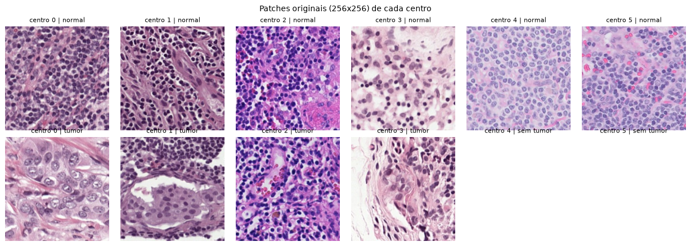
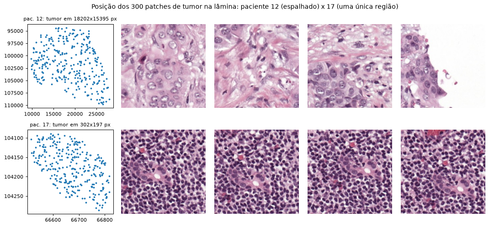
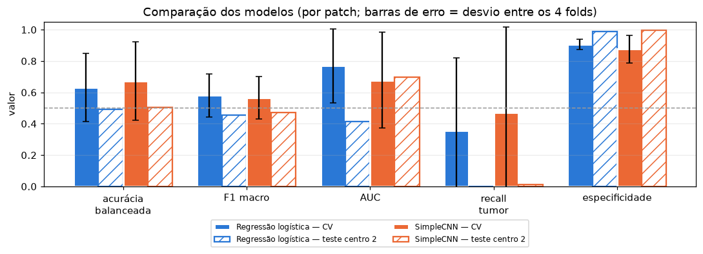
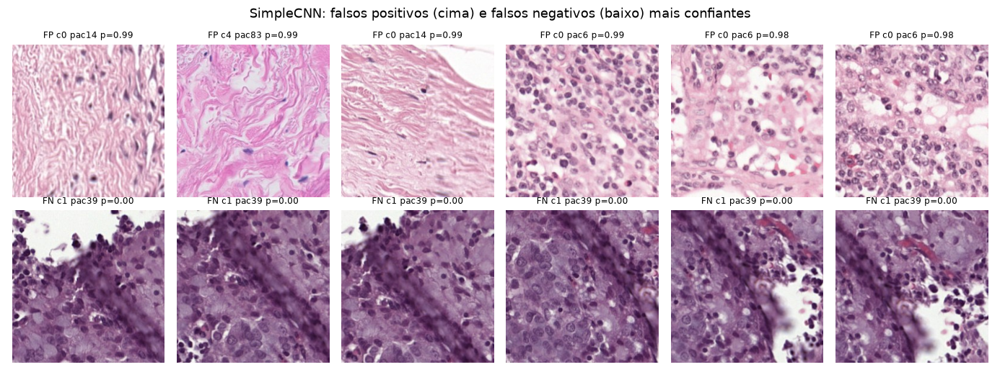

# PathoShift — Relatório da Entrega 1 (rascunho)

*Grupo: [nomes] · Processamento de Imagens · outubro de 2026*

## 1. Dados

Usamos o **MiniCAMELYON17** (Hugging Face `chehablab/MiniCAMELYON17`, revisão fixada no
`configs/default.yaml`), que tem 26.753 patches RGB de linfonodo corados com H&E, cada um rotulado como
normal ou tumor (metástase de câncer de mama).

Antes de escrever o código, conferimos o schema. O card do dataset estava desatualizado: os patches têm
**256×256** (e não 512×512), não existem as colunas `slide_id` e `stage`, e há **6 centros** (0 a 5).
Definimos uma lâmina como o par (paciente, nó); são 54 pacientes e 83 lâminas.

| centro | patches | tumor | % tumor | pacientes (com tumor) |
|---:|---:|---:|---:|---|
| 0 | 10.484 | 1.500 | 14,3 | 19 (5) |
| 1 | 6.639 | 31 | 0,5 | 15 (2) |
| 2 | 8.100 | 1.200 | 14,8 | 15 (4) |
| 3 | 630 | 30 | 4,8 | 2 (1) |
| 4 | 600 | 0 | 0 | 2 (0) |
| 5 | 300 | 0 | 0 | 1 (0) |

**Protocolo.** O **centro 2** ficou inteiro como **teste externo**, porque o objetivo é medir a robustez a um
hospital nunca visto, e só os centros 0 e 2 têm tumor suficiente. Os outros centros formam o conjunto de
desenvolvimento (18.653 patches, 8,4% de tumor), dividido em **4 folds por paciente** com
`StratifiedGroupKFold`. A divisão é por paciente porque patches do mesmo paciente são quase iguais, e
misturá-los seria vazamento. Exigimos ≥ 100 patches de tumor por fold (303, 300, 630 e 328).

## 2. Análise exploratória

- **A cor muda entre os centros** (figura 1): os histogramas de H e S de cada centro são diferentes. Isso
  confirma que a mudança de domínio é real.
- **O tumor está concentrado em poucos pacientes.** O dev tem 8 pacientes com tumor, mas só 5 com 300
  patches de tumor; os outros três têm 3, 28 e 30.
- **Tumor de região única.** Nos pacientes **16, 17** (dev) e **41** (centro 2), os 300 patches de tumor
  vêm de uma região de ~300×200 px da lâmina. Com patches de 256 px, isso é quase a mesma imagem repetida
  300 vezes (figura 2). Na prática, o dev tem só ~3 regiões de tumor diferentes.
- **Duplicatas.** Achamos 10 pares de patches idênticos e vários sobrepostos, sempre do mesmo paciente.
  Como a divisão é por paciente, eles não vazam entre treino e validação.

## 3. Pré-processamento e features (justificativas)

Usamos só técnicas vistas nas aulas.

- **Cor (Fundamentos):** convertemos para **HSV**, porque o canal S separa o fundo branco (S ≈ 0) do
  tecido corado. O histograma de 8 bins por canal gera 24 features.
- **Máscara de tecido (Segmentação + Morfologia):** a ideia inicial era Otsu no canal S, mas **não
  funcionou**. Só 10,5% dos pixels são fundo, e em quase todo patch o Otsu dividia o tecido em "núcleo ×
  estroma" (limiar mediano ≈ 60). Pelo vale do histograma de S, usamos um **limiar global S > 20**, depois
  de um Gaussiano σ = 4, seguido de abertura e fecho (figura 3).
- **Máscara de núcleos:** Otsu no cinza invertido, **calculado só com os pixels de tecido**. Calculado na
  imagem inteira, o Otsu separava fundo × tecido e marcava o tecido todo como núcleo. Depois vêm uma
  abertura 3×3 e os componentes conexos (removendo os de menos de 15 px). Daí saem 3 features: fração de
  área nuclear, número de núcleos e área média.
- **Filtros no espaço:** densidade de bordas (Gaussiano 5×5 + Sobel, fração com magnitude > 100) e
  variância do Laplaciano (nitidez).
- **Frequência:** fração da energia do espectro fora do raio D0 = 32 (o que um passa-alta ideal deixaria
  passar), calculada depois de subtrair a média.

São 30 features por patch, salvas em parquet. No dev, o tumor tem menos bordas (mediana 0,26 contra
0,42) e menor fração nuclear (0,37 contra 0,48), porque o tecido normal do linfonodo é cheio de
linfócitos pequenos e escuros.

## 4. Baselines

1. **Clássico:** `StandardScaler` + regressão logística com `class_weight="balanced"`. O scaler fica
   dentro do pipeline, ajustado só no treino de cada fold.
2. **SimpleCNN**, a rede do slide da aula de Classificação: Conv(32) → MaxPool → Conv(64) → MaxPool →
   Conv(64) → Flatten → Dense(64) → Dense(2), com 3,27 milhões de parâmetros. Entrada 128×128 com
   pixels/255.
   - Treino com CrossEntropy ponderada por N/(2·N_c), Adam com lr = 1e-4, lotes de 64 e aumentação
     (rotações de 90° e flips).
   - Com lr = 1e-3 o treino foi instável e, em algumas execuções, a loss ficou presa em ln 2 ≈ 0,69, ou
     seja, a rede respondia sempre 50/50.
   - **Early stopping:** dentro do treino de cada fold separamos ~1/5 dos pacientes (com tumor) como
     **conjunto de parada**. A rede para depois de 4 épocas sem melhorar a F1 macro nesse conjunto (no
     máximo 20). O fold de validação só é usado para medir.

## 5. Métricas

Como 91,6% do dev é normal, um modelo que diz sempre "normal" teria 91,6% de acurácia. Por isso
reportamos acurácia balanceada, F1 macro, AUC, recall do tumor e especificidade, **por patch** (média ±
desvio entre folds), **por paciente** (cada paciente pesa igual) e **por centro**. Nos centros sem tumor,
reportamos só a especificidade.

| métrica | Reg. log. (CV) | CNN (CV) | Reg. log. (centro 2) | CNN (centro 2) |
|---|---|---|---|---|
| acurácia balanceada | 0,632 ± 0,218 | 0,674 ± 0,250 | 0,494 | 0,504 |
| F1 macro | 0,581 ± 0,137 | 0,566 ± 0,134 | 0,457 | 0,471 |
| AUC | 0,770 ± 0,236 | 0,677 ± 0,306 | 0,416 | 0,698 |
| recall tumor | 0,358 ± 0,464 | 0,472 ± 0,544 | 0,000 | 0,012 |
| especificidade | 0,906 ± 0,035 | 0,876 ± 0,087 | 0,988 | 0,996 |
| acc. balanceada por paciente | 0,618 ± 0,214 | 0,639 ± 0,198 | 0,491 | 0,504 |

**Validação cruzada.** Os dois modelos ficam praticamente empatados, e o desvio é enorme. O recall de
tumor vai de 0 a 0,97 conforme o fold, porque cada fold depende de 1 ou 2 pacientes com tumor. O
paciente 17 (região única) foi errado pelos dois modelos.

O fold 2 da CNN previu tudo como normal: o conjunto de parada dele continha o paciente 16 (também de região
única), a F1 de parada não subiu e a parada escolheu a época 1. Uma versão preliminar (3 épocas, com a
melhor época escolhida olhando o próprio fold de validação) tinha F1 macro de 0,605. Ela era otimista por
construção, mas a comparação mistura duas mudanças (número de épocas e protocolo), então não dá para
atribuir a diferença só ao protocolo.

**Teste externo (centro 2, executado uma única vez com a configuração congelada).** Os dois modelos
praticamente só dizem "normal", com recall de tumor de 0 e 1,2%. A acurácia de 0,84–0,85 é só a fração de
normais. Há uma diferença importante:

- A **CNN ainda ordena** os patches (AUC 0,70; por paciente, 0,72, 0,92, 0,59 e 0,94). Os tumores recebem
  notas maiores que os normais, mas abaixo de 0,5. Ou seja, o limiar escolhido no dev não serve para a
  coloração do centro 2.
- A **regressão logística ordena pior que o acaso** (AUC 0,42): as features de cor e de núcleo mudam com
  a coloração (no centro 2, a mediana da área nuclear é 1.137 px, contra 283 px no centro 0).

## 6. Análise de erros

- **Mudança de domínio dentro do dev.** Os centros 4 e 5 só têm normais. A CNN marcou como tumor **42%
  (centro 4) e 88% (centro 5)** dos patches; a regressão logística, 1% e 0%.
- **Falsos positivos da CNN:** estroma rosa (pacientes 14 e 83) e tecido linfoide do paciente 6.
- **Falsos positivos da regressão logística:** fragmentos escuros e densos do centro 1.
- **Falsos negativos dos dois modelos:** principalmente o paciente 39 (centro 1, tecido roxo-escuro) e o
  paciente 17, cujos patches de "tumor" são quase só linfócitos, com um pequeno grupo de células maiores
  no centro.
- **Máscaras de núcleos:** falham em tecido escuro. O Otsu sempre cria duas classes e pode marcar o
  estroma inteiro como "núcleo" (um componente de 27 mil px), o que deixa ruidosa a feature de área média.

## 7. Custo computacional

Tudo rodou numa RTX 5060 (8 GB), com Python 3.12 e PyTorch 2.11 (CUDA 12.8); os tempos estão em
`outputs/run_info.json`.

| etapa | tempo |
|---|---|
| preparação dos dados | 1,7 s |
| features (26.753 patches) | 186 s |
| CV da regressão logística | 0,5 s |
| CV da CNN (4 folds, 5–15 épocas) | 240 s |
| CNN final | 94 s |
| teste externo | 27 s |
| **total** | **~9,3 min** |

Uma época da CNN leva ~5 s; a regressão logística treina em menos de 1 s. Com seed fixa e cuDNN
determinístico, duas execuções iguais da CNN deram resultados idênticos.

## 8. Limitações

1. **Poucos pacientes com tumor:** são 5 com 300 patches no dev, e 3 lâminas (pacientes 16, 17 e 41) têm
   tumor de região única. As métricas de CV têm desvio de ±0,2 a ±0,5, e a diferença entre os modelos
   não é conclusiva.
2. **O conjunto de parada tira pacientes com tumor do treino.** No modelo final, ele levou o paciente 12,
   que tem o tumor mais variado.
3. **Limiar fixo em 0,5**, sem calibração: no centro 2 ele ficou alto demais (a AUC da CNN mostra que
   havia informação para separar as classes).
4. **Sem normalização de cor:** a equalização do canal V está implementada mas não foi usada. Os dois
   modelos são sensíveis à coloração (centros 2, 4 e 5).
5. **Parâmetros escolhidos à mão** (S > 20, Sobel > 100, D0 = 32, kernels). A amostra exploratória
   inicial usada para escolher os limiares de S e do Sobel incluía imagens (sem rótulos) do centro 2.
6. Não sabemos o critério exato de rotulagem do dataset: no paciente 17, as células tumorais ocupam uma
   parte pequena do patch.

**Próximos passos (Entregas 2 e 3):** agregar as predições por lâmina (`src/aggregate.py`, já pronto),
testar robustez a ruído e desfoque (`src/restoration.py`, já pronto) e avaliar formas de reduzir a
dependência da cor usando técnicas das aulas.

*Uso de IA:* o código e este rascunho foram produzidos com apoio do Claude Code. O que foi gerado e como
foi verificado (testes automatizados, inspeção visual das máscaras, diagnósticos) está registrado em
`docs/referencia/REFERENCIA_COMPLETA.md`, seção 14.
